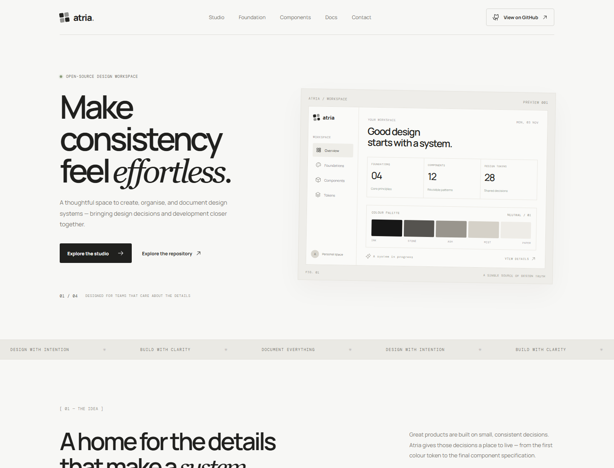
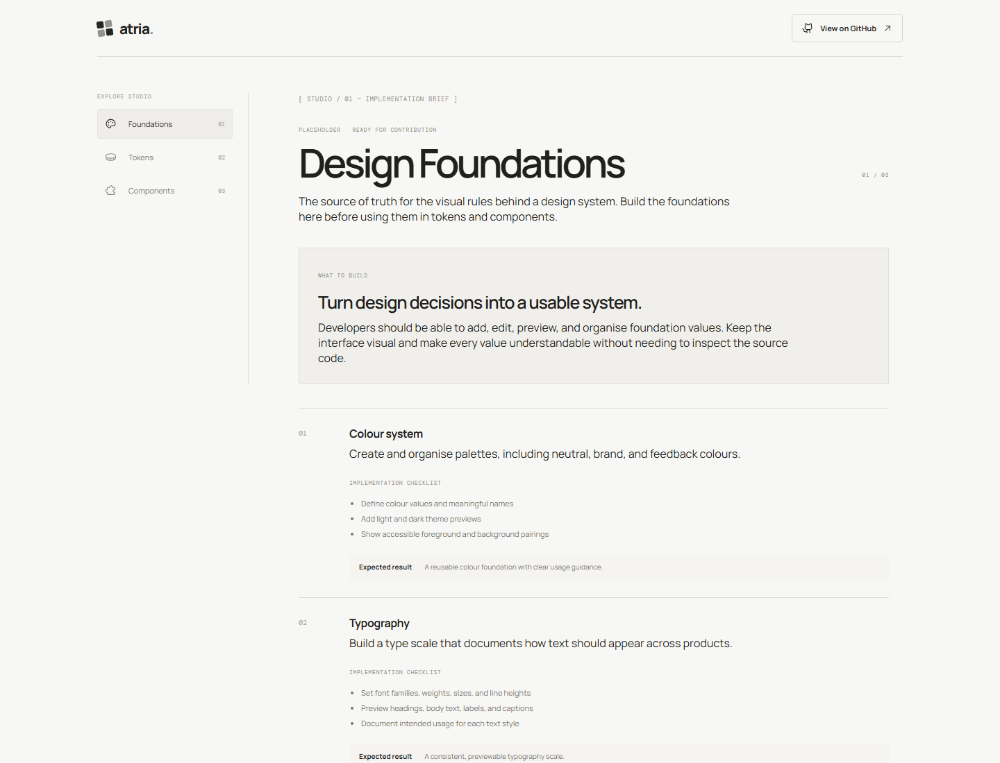
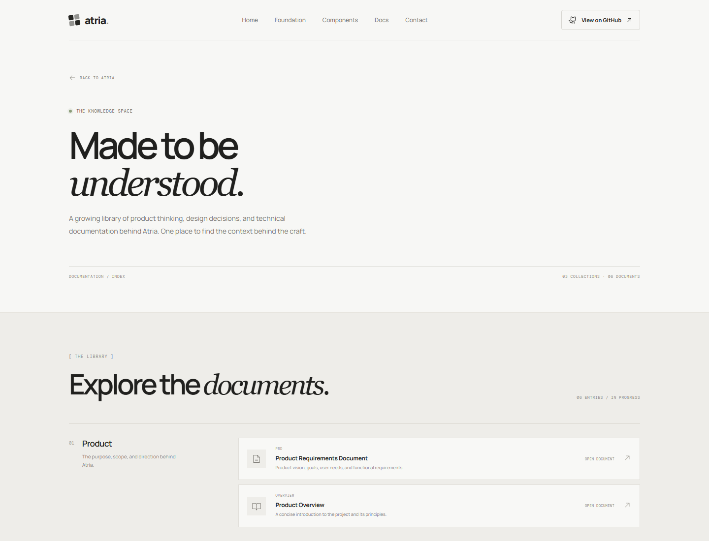
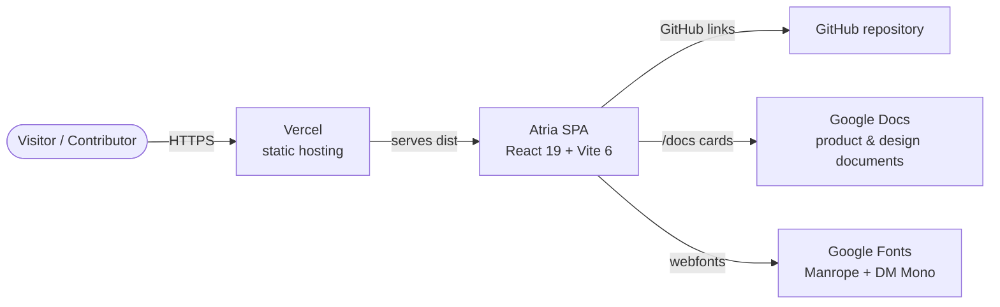
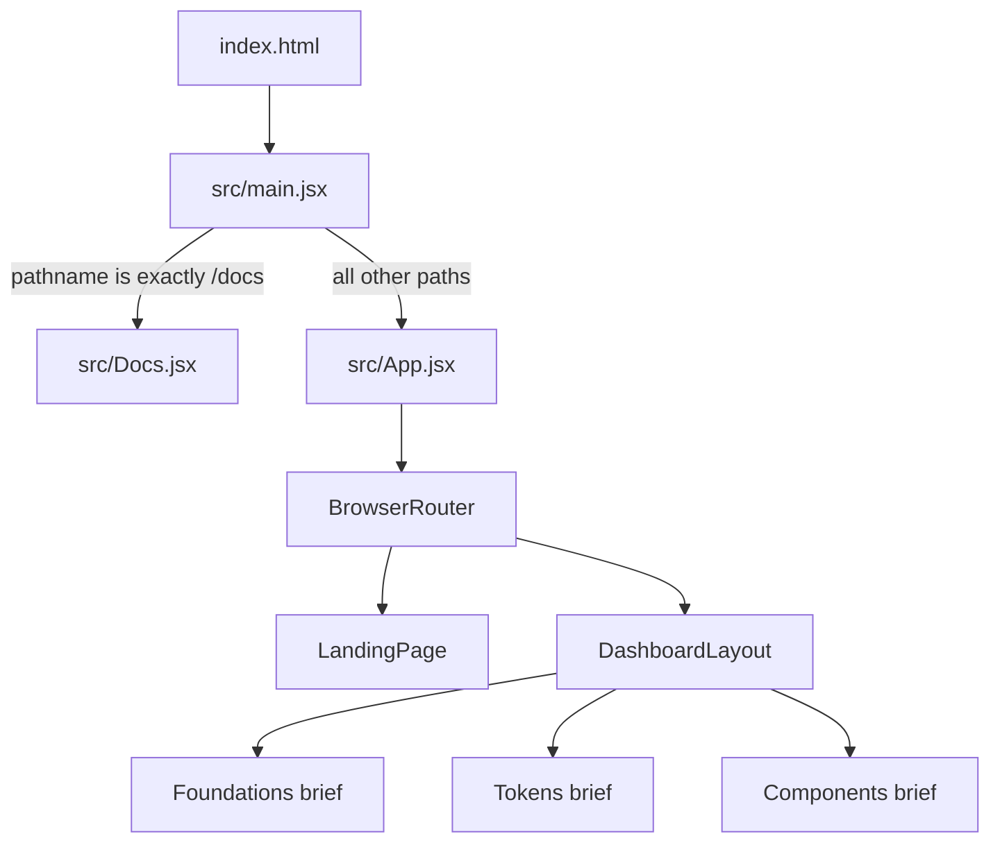
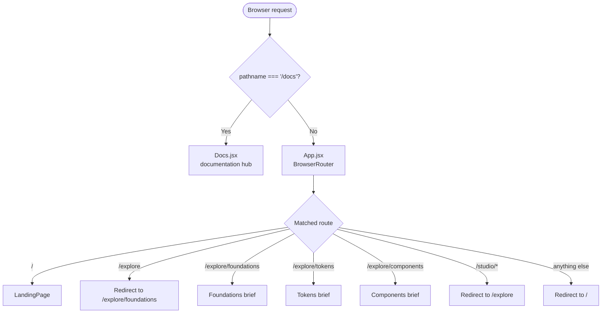
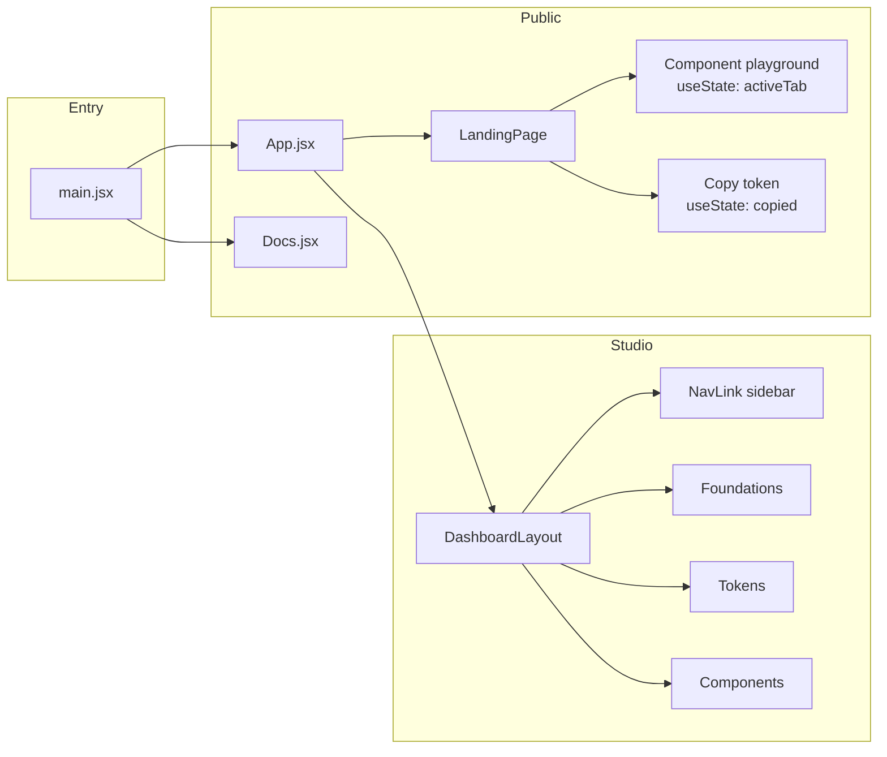
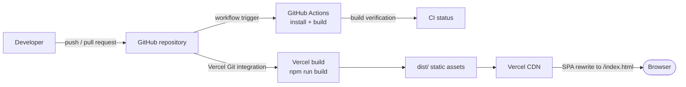

<div align="center">
  
</div>

<div align="center">

### Design, structure, and consistency.

**Atria is an open-source workspace for creating, managing, and documenting design systems.**

It brings design foundations, reusable design tokens, component guidance, and product documentation into one considered space — built for the people who care about the details.

<br />

[](https://react.dev/)
[](https://vite.dev/)
[](https://reactrouter.com/)
[](https://phosphoricons.com/)
[](LICENSE)
[](#project-status)
[](CONTRIBUTING.md)

<br />

[**Live Demo**](https://atriastudio.vercel.app) · [**Documentation**](https://atriastudio.vercel.app/docs) · [**Explore Studio**](https://atriastudio.vercel.app/explore/foundations) · [**Repository Docs**](docs/README.md) · [**Report an Issue**](https://github.com/breeze-sn/Atria/issues)

</div>

---

> [!IMPORTANT]
> **Project status — early development (NSoC Winter Edition 2026).**
> The public landing page, documentation hub, routing shell, and responsive visual system are implemented.
> The **Foundations**, **Tokens**, and **Components** areas inside Explore Studio are currently
> **contributor-facing implementation briefs**, not working editors. This README distinguishes
> implemented behaviour from planned direction so contributors can trust what they read.

---

## Table of contents

- [Project overview](#project-overview)
- [Why Atria exists](#why-atria-exists)
- [Current capabilities](#current-capabilities)
- [Visual tour](#visual-tour)
- [System at a glance](#system-at-a-glance)
- [Verified technology stack](#verified-technology-stack)
- [Quick start](#quick-start)
- [Available scripts](#available-scripts)
- [Project structure](#project-structure)
- [How the application is composed](#how-the-application-is-composed)
- [Documentation index](#documentation-index)
- [Architecture diagrams](#architecture-diagrams)
- [Development workflow](#development-workflow)
- [Testing and quality](#testing-and-quality)
- [Roadmap](#roadmap)
- [Contributing](#contributing)
- [Security](#security)
- [License](#license)

---

## Project overview

Atria is a design-system studio for teams, students, and independent creators who want their design
decisions to live somewhere structured. The product direction is to provide a single workspace for
defining foundations, managing design tokens, documenting reusable components, and exporting
developer-ready decisions.

The current repository implements the **frontend foundation** of that vision:

- a considered public landing page that explains the product and demonstrates its visual language;
- a documentation hub that indexes product, design, and engineering documents;
- an Explore Studio shell with navigation for Foundations, Tokens, and Components;
- detailed implementation briefs that describe the next contribution surface for each Studio area;
- a responsive, accessible-by-intent CSS system with reduced-motion support;
- a production build and deployment configuration for a Vite single-page application.

The project is deliberately honest about its maturity. The shell exists, the visual language exists,
and the implementation briefs exist. The data model, persistence layer, export pipeline, and working
editors do not exist yet.

## Why Atria exists

Design systems fail when their decisions are scattered across design files, code comments, chat
threads, and people's memories. The result is visual drift, duplicated components, and documentation
that no longer matches the product.

Atria's core idea is simple: **give every design decision a clear place to live**.

```
Foundation values  →  Semantic tokens  →  Components  →  Product interfaces
      colour              colour.text        Button            consistent UI
      type                space.4            Input
      spacing             radius.sm          Badge
```

The intended workflow bridges two disciplines:

| Discipline | What they need | What Atria aims to provide |
|---|---|---|
| Design | A structured place to define and preview foundations | Foundations workspace, palettes, type scales, spacing rules |
| Engineering | Stable names, values, and implementation guidance | Token references, export formats, component APIs |
| Product teams | A shared source of truth | Documentation, versioned decisions, discoverability |
| Contributors | Clear, accurate context | Repo documentation, implementation briefs, verified setup |

## Current capabilities

This matrix reflects the code in this repository today. It is intentionally conservative.

| Area | Status | What actually exists |
|---|---|---|
| Public landing page | **Implemented** | Hero, workspace preview, principles ticker, foundation cards, component playground, token copy demo, contact section, footer |
| Documentation hub (`/docs`) | **Implemented** | Three collections and six outbound document cards, with responsive layout |
| Explore Studio shell (`/explore`) | **Implemented** | Top navigation, section sidebar, footer, nested routes |
| Foundations workspace | **Placeholder** | Static implementation brief describing the editor contributors should build |
| Tokens workspace | **Placeholder** | Static implementation brief describing token structure, groups, validation, and exports |
| Components workspace | **Placeholder** | Static implementation brief describing the component registry and documentation model |
| Component playground | **Implemented, limited** | Landing-page tab switch between Button, Input, and Badge examples; preview only |
| Copy token interaction | **Implemented, limited** | Copies the literal string `--atria-space-4: 16px;` to the clipboard |
| Design token exports | **Not implemented** | CSS variables and JSON export are described as roadmap, not delivered |
| Persistence, API, database | **Not implemented** | No backend, server, database, ORM, or API calls exist |
| Authentication / accounts | **Not implemented** | No login, user model, or protected routes |
| Automated tests | **Not configured** | No test runner or test files are installed |
| Linting | **Not configured** | No lint script or linter configuration is present |

For a detailed, section-by-section breakdown, read [Current features](docs/features/README.md).

## Visual tour

The screenshots below were captured from a local production build of this repository. They are real
renders of the current implementation, not concept art.

<table>
  <tr>
    <td width="50%">
      <strong>Public landing page</strong><br />
      
    </td>
    <td width="50%">
      <strong>Explore Studio — Foundations brief</strong><br />
      
    </td>
  </tr>
  <tr>
    <td width="50%">
      <strong>Documentation hub</strong><br />
      
    </td>
    <td width="50%">
      <strong>Run it yourself</strong><br />
      <code>npm install</code><br />
      <code>npm run dev</code><br />
      <br />
      Visit <code>/</code>, <code>/explore</code>, and <code>/docs</code> to see every implemented route.
    </td>
  </tr>
</table>

## System at a glance

Atria is a **client-rendered single-page application**. A small entry branch decides whether to mount
the documentation hub or the main router. There is no server-side rendering, API, or database.





Read the full [system architecture](docs/architecture/system-architecture.md) for boundaries,
rendering behaviour, and quality attributes.

## Verified technology stack

Everything in this table is either declared in `package.json`, resolved in `package-lock.json`, or
present in the repository configuration.

| Layer | Technology | Version / source | Role |
|---|---|---|---|
| UI framework | [React](https://react.dev/) | `^19.1.0` | Component rendering and local UI state |
| DOM client | [React DOM](https://react.dev/) | `^19.1.0` | Browser rendering via `createRoot` |
| Routing | [React Router](https://reactrouter.com/) | `^7.18.5` | Nested routes, redirects, and active navigation |
| Icons | [Phosphor Icons for React](https://phosphoricons.com/) | `^2.1.10` | Interface and illustrative iconography |
| Build tool | [Vite](https://vite.dev/) | `^6.3.5` (lockfile resolved 6.4.5) | Dev server, HMR, production bundling |
| React plugin | [@vitejs/plugin-react](https://github.com/vitejs/vite-plugin-react) | `^4.7.0` | JSX transform and React fast refresh |
| Language | JavaScript / JSX | ES modules (`"type": "module"`) | Application source |
| Styling | Hand-written CSS | `src/index.css` | Layout, visual language, responsiveness, motion |
| Typefaces | Manrope + DM Mono | Google Fonts in `index.html` | Editorial sans + technical mono pairing |
| CI | GitHub Actions | `.github/workflows/ci.yml` | Install dependencies and verify production build |
| Hosting | Vercel | `vercel.json` | Static build, SPA fallback rewrites |

### Not currently installed

The following technologies appeared in earlier project notes but are **not present** in this
codebase. They are not required to run Atria today.

| Technology | Actual state |
|---|---|
| Tailwind CSS | Not installed. All styling is hand-written CSS. |
| Radix UI | Not installed. |
| Node.js / Express.js | No backend or server application exists. |
| PostgreSQL / Prisma | No database, schema, migrations, or ORM exist. |
| Vitest / Playwright | No test runner or end-to-end tooling is installed. |

These may become relevant as the Studio becomes functional. Until then, documentation will label
them as **planned**, not completed.

## Quick start

### Prerequisites

- **Node.js 20 or newer** — the CI workflow uses Node.js 20.
- **npm** — bundled with Node.js; the repository includes a lockfile.
- **Git** — to clone and contribute.

### Install and run

```bash
# 1. Clone the repository
git clone https://github.com/breeze-sn/Atria.git
cd Atria

# 2. Install dependencies
npm install

# 3. Start the development server
npm run dev
```

Vite prints a local URL, typically **http://localhost:5173**. Open it in a modern browser.

### Build and preview

```bash
npm run build
npm run preview
```

The production bundle is written to `dist/`. `npm run preview` serves it locally.

### Routes to verify

| URL | Expected result |
|---|---|
| `/` | Public landing page |
| `/docs` | Documentation hub |
| `/explore` | Redirects to `/explore/foundations` |
| `/explore/foundations` | Foundations implementation brief |
| `/explore/tokens` | Tokens implementation brief |
| `/explore/components` | Components implementation brief |
| `/studio/...` | Redirects to `/explore` |
| Any unknown route | Redirects to `/` |

**No environment variables are required.** See
[environment configuration](docs/getting-started/environment-configuration.md) for the full
explanation and safe conventions for adding configuration later.

## Available scripts

| Command | What it does | Verified |
|---|---|---|
| `npm run dev` | Starts the Vite development server with hot module replacement | Yes |
| `npm run build` | Produces an optimised production build in `dist/` | Yes |
| `npm run preview` | Serves the production build locally | Yes |

There is currently **no** `npm test` or `npm run lint` script. The CI workflow calls
`npm run lint --if-present`, which exits successfully without running a linter because the script is
absent. See [CI/CD](docs/deployment/ci-cd.md) for details.

## Project structure

```text
Atria/
├── .github/
│   ├── workflows/
│   │   └── ci.yml                    # Install dependencies and build on push/PR
│   └── PULL_REQUEST_TEMPLATE.md      # Required pull request structure
├── docs/                             # Repository documentation library
│   ├── architecture/                 # System design, HLD, LLD, data flow, ADRs
│   ├── assets/                       # Banner and verified screenshots
│   ├── contributing/                 # Workflow, PR, debugging, writing standards
│   ├── deployment/                   # Build, hosting, CI/CD
│   ├── engineering/                  # Frontend, routing, styling, state, security
│   ├── features/                     # Implemented features and Studio briefs
│   ├── getting-started/              # Installation, local development, environment
│   ├── quality/                      # Testing, accessibility, coding standards
│   └── README.md                     # Documentation index and reading paths
├── src/
│   ├── layouts/
│   │   └── DashboardLayout.jsx       # Explore Studio shell and sidebar navigation
│   ├── pages/
│   │   ├── Foundations.jsx           # Static Foundations implementation brief
│   │   ├── Tokens.jsx                # Static Tokens implementation brief
│   │   └── Components.jsx            # Static Components implementation brief
│   ├── App.jsx                       # Landing page + application routes
│   ├── Docs.jsx                      # Documentation hub rendered at /docs
│   ├── index.css                     # Global design system and all page styles
│   └── main.jsx                      # Browser entry and /docs branch
├── index.html                        # HTML shell, fonts, metadata
├── package.json                      # Dependencies and scripts
├── package-lock.json                 # Locked dependency graph
├── vercel.json                       # Vercel build and SPA rewrite configuration
├── vite.config.js                    # Vite + React plugin configuration
├── CONTRIBUTING.md                   # Contribution workflow
├── CODE_OF_CONDUCT.md                # Community expectations
├── SECURITY.md                       # Security policy
├── CHANGELOG.md                      # Release history
└── LICENSE                           # MIT license
```

## How the application is composed

1. `index.html` loads `src/main.jsx`.
2. `src/main.jsx` checks `window.location.pathname`. If it is exactly `/docs`, it renders
   `src/Docs.jsx`; otherwise it renders `src/App.jsx`.
3. `src/App.jsx` creates a `BrowserRouter` and defines the landing page plus the `/explore` route
   tree.
4. `src/layouts/DashboardLayout.jsx` provides the Explore header, sticky section sidebar, shared
   footer, and an `<Outlet />` for the selected section.
5. Each Studio page renders a static implementation brief from a local data array.
6. `src/index.css` contains the full visual system: CSS custom properties, typography, layout,
   responsive breakpoints, transitions, and reduced-motion handling.

This is deliberately simple. There is no global store, context provider, data-fetching layer, or
abstraction that the current feature set does not justify.

## Documentation index

The full index lives at [`docs/README.md`](docs/README.md). Start with the path that matches your
goal.

### Understand the system

| Document | What it answers |
|---|---|
| [Documentation hub](docs/README.md) | Where everything lives and which path to read |
| [System architecture](docs/architecture/system-architecture.md) | What the system is, its boundaries, and runtime model |
| [High-level design](docs/architecture/high-level-design.md) | Actors, capabilities, containers, and request lifecycle |
| [Low-level design](docs/architecture/low-level-design.md) | Files, data shapes, handlers, routes, and CSS structure |
| [Component architecture](docs/architecture/component-architecture.md) | Component tree, responsibilities, and coupling |
| [Data flow](docs/architecture/data-flow.md) | Where data comes from, how it moves, and what is static |
| [Architecture diagrams](docs/architecture/diagrams.md) | All Mermaid diagrams in one gallery |
| [Architecture decisions](docs/architecture/architecture-decisions.md) | ADR index and rationale |

### Build and run

| Document | What it answers |
|---|---|
| [Installation](docs/getting-started/installation.md) | Prerequisites, install, run, build, verify |
| [Local development](docs/getting-started/local-development.md) | Day-to-day development loop and route checks |
| [Environment configuration](docs/getting-started/environment-configuration.md) | Why no env vars are needed today |

### Understand the product

| Document | What it answers |
|---|---|
| [Feature overview](docs/features/README.md) | Implemented vs. placeholder vs. planned |
| [Landing page](docs/features/landing-page.md) | Sections, interactions, and limitations |
| [Explore Studio](docs/features/explore-studio.md) | Shell, navigation, and placeholder model |
| [Design foundations](docs/features/design-foundations.md) | The brief contributors are asked to implement |
| [Design tokens](docs/features/design-tokens.md) | Token model, validation, and export direction |
| [Component library](docs/features/component-library.md) | Registry and documentation direction |
| [Documentation hub](docs/features/documentation-hub.md) | `/docs` structure and external links |
| [API reference](docs/features/api-reference.md) | Confirms no API exists yet |

### Work on the code

| Document | What it answers |
|---|---|
| [Frontend architecture](docs/engineering/frontend-architecture.md) | Entry points, components, imports, CSS |
| [Routing](docs/engineering/routing.md) | Route table, redirects, `/docs` branch, pitfalls |
| [Styling and tokens](docs/engineering/styling-and-design-tokens.md) | CSS variables, palette, type, breakpoints |
| [State management](docs/engineering/state-management.md) | Local state, URL state, and what is absent |
| [Application workflows](docs/engineering/application-workflows.md) | Visitor, reader, explorer, and contributor journeys |
| [Error handling](docs/engineering/error-handling.md) | Current safeguards and known gaps |
| [Security and authentication](docs/engineering/security-and-authentication.md) | Client-only threat model |
| [Performance](docs/engineering/performance.md) | Bundle baseline and optimisation opportunities |
| [Testing strategy](docs/quality/testing-strategy.md) | Manual verification and future test layers |
| [Accessibility](docs/quality/accessibility.md) | Present features, gaps, and manual checks |
| [Coding standards](docs/quality/coding-standards.md) | Observed conventions and review rules |
| [Contribution workflow](docs/contributing/contribution-workflow.md) | Fork, branch, commit, and PR flow |
| [Pull request guidelines](docs/contributing/pull-request-guidelines.md) | Required PR format and checklist |
| [Debugging](docs/contributing/debugging.md) | Common setup and runtime issues |
| [Documentation guidelines](docs/contributing/documentation-guidelines.md) | Accuracy, status labels, Mermaid, link checks |

## Architecture diagrams

### Application routing



### Component interaction



### Data flow

```mermaid
flowchart LR
  Constants[Local constant arrays] --> JSX[React render]
  Router[URL / router state] --> JSX
  State[useState<br/>activeTab / copied] --> JSX
  User([User interaction]) --> State
  User --> Clipboard[navigator.clipboard]
  JSX --> DOM[Rendered interface]
  DocsLinks[Google Docs URLs] --> DocsPage[/docs outbound cards]
```

There is **no** API request, server action, database query, authentication check, or persistence layer
in the current data flow. The full diagram set lives in
[architecture diagrams](docs/architecture/diagrams.md).

### Deployment



GitHub Actions verifies the build but does **not** deploy; deployment is configured through Vercel.
See [build and deployment](docs/deployment/build-and-deployment.md).

## Development workflow

A typical contribution loop:

```bash
# 1. Create a branch from an up-to-date main
git checkout main
git pull origin main
git checkout -b docs/improve-readme

# 2. Make a focused change
# ...edit files...

# 3. Verify the production build
npm run build

# 4. Review your diff
git status
git diff

# 5. Commit and push
git add README.md docs/
git commit -m "docs: redesign README and expand documentation library"
git push origin docs/improve-readme
```

Then open a pull request against `main` using the repository PR template. Keep changes scoped, explain
what you changed and why, include screenshots for visual changes, and confirm every documentation link.

More detail:

- [Contribution workflow](docs/contributing/contribution-workflow.md)
- [Pull request guidelines](docs/contributing/pull-request-guidelines.md)
- [Coding standards](docs/quality/coding-standards.md)

## Testing and quality

There is currently **no automated test suite**. Quality is verified through:

1. **Production build** — `npm run build` must succeed.
2. **CI** — GitHub Actions runs install + build on every push and pull request to `main`.
3. **Manual route checks** — `/`, `/docs`, `/explore`, all three Studio sections, redirects, and the
   unknown-route fallback.
4. **Manual interaction checks** — playground tabs, copy-token feedback, clipboard failure path, and
   sidebar active states.
5. **Responsive checks** — the CSS defines breakpoints at 850px, 800px, 700px, 650px, and 600px.
6. **Reduced-motion check** — `prefers-reduced-motion` disables transitions and animations.

Use the full [manual test matrix](docs/quality/testing-strategy.md) before opening a PR that touches
routing, layout, or interactions.

## Roadmap

The roadmap below is derived from the in-repository implementation briefs. Items are **directional**
and are not implemented unless the capability matrix above says so.

| Horizon | Direction | Source |
|---|---|---|
| **Now** | Keep the landing page, documentation hub, and Studio shell accurate and accessible | Current implementation |
| **Next** | Build a Foundations editor with colour, typography, and spacing previews | `src/pages/Foundations.jsx` brief |
| **Next** | Build a token workspace with groups, references, validation, and CSS/JSON export | `src/pages/Tokens.jsx` brief |
| **Next** | Build a component registry with metadata, variants, isolated previews, and usage guidance | `src/pages/Components.jsx` brief |
| **Later** | Introduce persistence so foundations, tokens, and components can be saved and shared | Developer notes in all three briefs |
| **Later** | Add authentication, team workspaces, and community publishing | Product direction; not implemented |
| **Later** | Add automated component, integration, and accessibility tests | Quality direction; not configured |

If you want to work on a roadmap item, open an issue first so the scope and data model can be agreed
before implementation.

## Contributing

Contributions are welcome from designers, frontend developers, technical writers, and anyone who
cares about developer experience.

Good first contributions include:

- improving documentation accuracy and navigation;
- refining responsive behaviour and accessibility;
- strengthening the visual system without changing product scope;
- implementing one Studio brief with tests and a clear data model;
- fixing bugs with a focused reproduction.

Before you start:

1. Read [CONTRIBUTING.md](CONTRIBUTING.md).
2. Follow the [contribution workflow](docs/contributing/contribution-workflow.md).
3. Use the [pull request guidelines](docs/contributing/pull-request-guidelines.md).
4. Follow the [documentation guidelines](docs/contributing/documentation-guidelines.md) for any docs
   change.
5. Be kind and follow the [Code of Conduct](CODE_OF_CONDUCT.md).

## Security

Atria is currently a client-only application with no authentication, user accounts, API, database, or
server-side data processing. Do not include secrets, tokens, or private credentials in the repository.

To report a vulnerability, follow [SECURITY.md](SECURITY.md). Please do not open a public issue for a
security-sensitive report.

## License

Atria is licensed under the [MIT License](LICENSE).

Copyright © 2026 Atria contributors.

---

<div align="center">

**Design with intention. Build with clarity. Document everything.**

If Atria is useful to you, consider starring the repository and sharing it with someone who cares
about the details.

[](https://github.com/breeze-sn/Atria)

<sub>Built with care by the Atria community.</sub>

</div>
