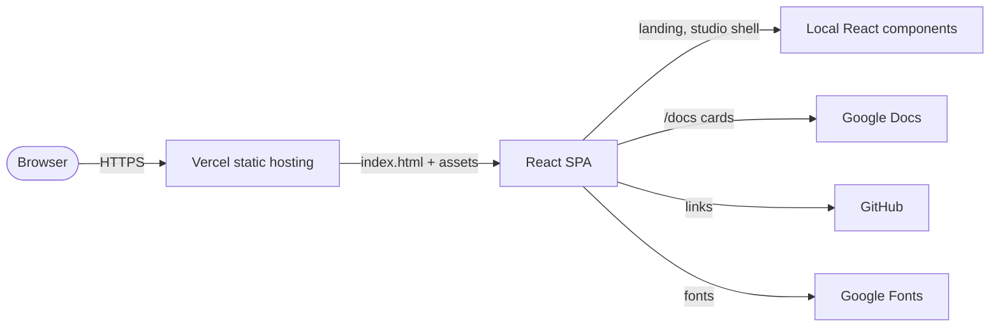

# Architecture

This directory explains the structure of Atria as it is implemented today. It is written for
contributors who need to change the code safely, reviewers who need to reason about impact, and
maintainers who need a shared record of design decisions.

The architecture set is intentionally proportionate to the product. Atria is a small client-side
React application with no backend, database, authentication, or persistence. The documentation does
not pretend otherwise. It describes the real boundaries and marks future direction as planned.

---

## Documents

| Document | Purpose | Best for |
|---|---|---|
| [System architecture](system-architecture.md) | Context, runtime model, boundaries, deployment, quality attributes | First architectural read |
| [High-level design](high-level-design.md) | Actors, capability map, containers, lifecycle, evolution | Product and system overview |
| [Low-level design](low-level-design.md) | Files, functions, data shapes, handlers, CSS groups, edge cases | Implementation work |
| [Component architecture](component-architecture.md) | Component tree, responsibilities, coupling, duplication, extension points | UI changes |
| [Data flow](data-flow.md) | Static sources, interaction state, clipboard, external links, absent persistence | Understanding behaviour |
| [Diagrams](diagrams.md) | Six Mermaid views: context, application, interaction, data, workflow, deployment | Visual reference |
| [Architecture decisions](architecture-decisions.md) | ADR index and summary of tradeoffs | Decision review |
| [ADR directory](adr/README.md) | Individual records for each accepted decision | Historical context |

---

## Architectural summary

Atria is a **single-page, client-rendered application**.

Key facts:

- **Framework:** React 19 with JSX, built by Vite 6.
- **Routing:** React Router 7 for `/`, `/explore/*`, and redirects.
- **Documentation hub:** `/docs` is rendered by a pathname branch in `src/main.jsx`, outside the
  router.
- **Styling:** one global CSS file with CSS custom properties, not Tailwind or CSS-in-JS.
- **State:** local `useState` only; URL is the source of truth for navigation.
- **Data:** static arrays in source files. No API, database, or persistence.
- **Deployment:** static `dist/` output with SPA fallback rewrites on Vercel.
- **Quality automation:** GitHub Actions installs dependencies and verifies the production build.
  There are no automated tests or lint scripts.
- **Product maturity:** the shell and landing experience are implemented; Studio workspaces are
  implementation briefs.

---

## How to use this set

1. Read [System architecture](system-architecture.md) for the complete picture.
2. Read [High-level design](high-level-design.md) for actors and capability boundaries.
3. Read [Low-level design](low-level-design.md) before editing source files.
4. Read [Component architecture](component-architecture.md) before changing UI composition.
5. Read [Data flow](data-flow.md) before adding data or interactions.
6. Read [Architecture decisions](architecture-decisions.md) before proposing structural changes.

When a change alters a documented boundary, update the relevant document in the same pull request.
Architecture documentation that drifts from the code is treated as a defect.

---

## Documentation accuracy notes

- All file paths in this directory refer to files present in the repository.
- Versions are taken from `package.json`, `package-lock.json`, or CI configuration.
- Diagrams use Mermaid so they stay readable in GitHub, IDEs, and code review.
- Anything not present in the repository is labelled **not implemented** or **planned**.
- Screenshots and the banner are stored in [`docs/assets`](../assets/README.md) with provenance notes.
