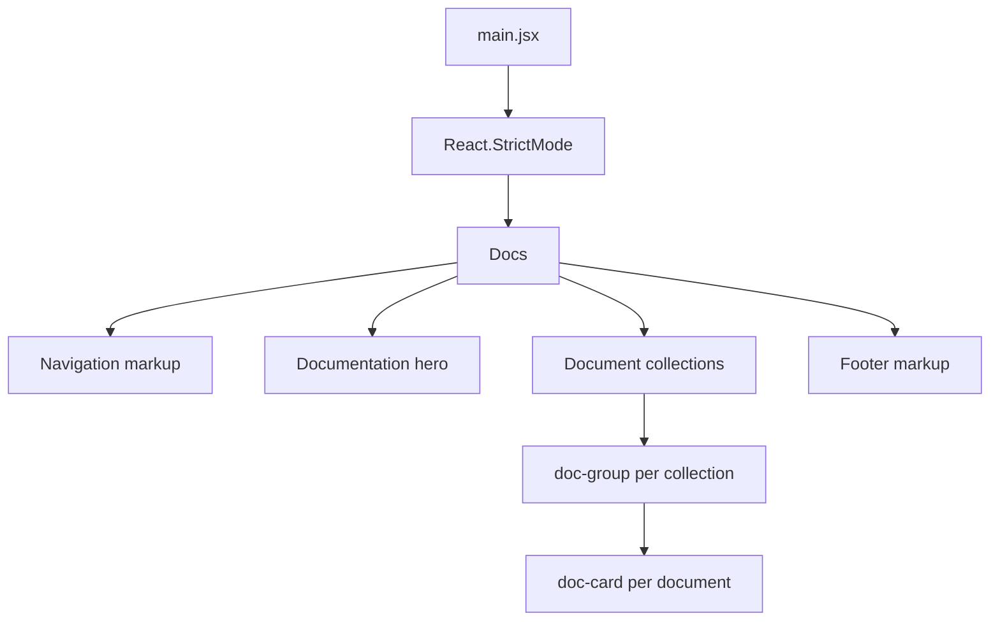
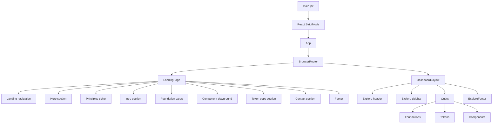
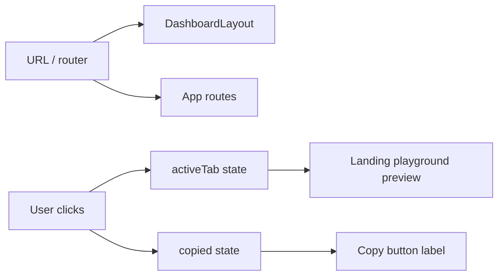

# Component Architecture

## Purpose

This document describes how Atria's user interface is composed from React components. It covers the
component tree, responsibilities, state ownership, shared visual patterns, duplication, coupling, and
extension points.

Atria has a small component surface. Most "components" are sections inside larger page functions
rather than separate files. This is accurate to the current code and should be understood before
proposing a refactor.

---

## 1. Component tree

### 1.1 Documentation branch

### 1.2 Application branch

---

## 2. Component inventory

| Component | File | Type | Props | State | Children |
|---|---|---|---|---|---|
| `App` | `src/App.jsx` | Route container | None | None | `BrowserRouter`, `Routes` |
| `LandingPage` | `src/App.jsx` | Page function | None | `activeTab`, `copied` | Sections and footer |
| `Docs` | `src/Docs.jsx` | Page function | None | None | Navigation, hero, groups, footer |
| `AtriaMark` | `src/layouts/DashboardLayout.jsx` | Presentational | `small` | None | Four span elements |
| `ExploreFooter` | `src/layouts/DashboardLayout.jsx` | Presentational | None | None | Footer markup |
| `DashboardLayout` | `src/layouts/DashboardLayout.jsx` | Layout | None | None | Header, sidebar, `Outlet`, footer |
| `Foundations` | `src/pages/Foundations.jsx` | Page function | None | None | Brief sections |
| `Tokens` | `src/pages/Tokens.jsx` | Page function | None | None | Brief sections |
| `Components` | `src/pages/Components.jsx` | Page function | None | None | Brief sections |

Only `AtriaMark` accepts a prop. No component receives data as props from a parent; every page owns or
imports its own static data.

---

## 3. Responsibilities

### LandingPage

Owns the entire public experience:

- product positioning and hero;
- abstract workspace preview built from markup and CSS;
- principles ticker;
- foundation cards;
- interactive component playground;
- token copy demonstration;
- contact links;
- footer.

It is the most stateful and most visually complex component in the repository.

### Docs

Owns the documentation hub:

- document collections and cards;
- external Google Docs links;
- documentation navigation and footer.

It is entirely static. Its only "interaction" is following links.

### DashboardLayout

Owns the persistent Studio frame:

- top header with brand and GitHub CTA;
- sticky section sidebar with active states;
- content outlet;
- footer.

It does not render section content directly. Each child route renders its own brief.

### Studio brief pages

Own static contributor guidance for one section each. They do not share a brief component; they share
CSS classes and a visual pattern.

### AtriaMark

Owns the four-square rotated brand mark. Used in the Explore header and footer. The landing page and
Docs page duplicate the mark markup instead of using this component.

---

## 4. State ownership

| State | Owner | Scope | Persistence |
|---|---|---|---|
| Current route | React Router / browser URL | Application | Browser history |
| `activeTab` | `LandingPage` | Landing page | None; resets on unmount |
| `copied` | `LandingPage` | Landing page | None; resets after 1.8s or unmount |
| Sidebar active state | `NavLink` derived from URL | Explore layout | Browser URL |

There is no context provider, global store, reducer, or persistence.

---

## 5. Shared visual patterns

Atria reuses visual patterns through CSS, not through shared React components.

| Pattern | Implemented in CSS | Used by |
|---|---|---|
| `.shell` container | Global | Landing, Docs, Explore |
| `.brand` wordmark | Global | Landing nav/footer, Docs nav/footer, Explore header/footer |
| `.brand-mark` | Global | Landing, Docs, Explore |
| `.nav` | Global | Landing, Docs, Explore |
| `.nav-cta` | Global | All navigation bars |
| `.footer` / `.footer-top` / `.footer-bottom` | Global | Landing, Docs, Explore |
| `.section-index` | Global | Landing, Docs, Explore briefs |
| `.studio-*` | Global | All Studio briefs |
| `.doc-*` | Global | Documentation hub |

This keeps the markup local and easy to read, but it means brand or footer changes may need edits in
three files.

---

## 6. Duplication and coupling

### Known duplication

1. **Brand mark markup** — implemented in `LandingPage`, `Docs`, and `AtriaMark`.
2. **Footer markup** — separate in `LandingPage`, `Docs`, and `ExploreFooter`.
3. **Navigation markup** — separate in landing and docs; Explore has its own compact header.
4. **Brief structure** — three pages repeat the same wrapper and heading pattern.
5. **Section index labels** — repeated strings with similar structure.

### Coupling

- Pages depend directly on global CSS class names.
- `Docs` depends on hard-coded Google Docs URLs.
- `DashboardLayout` depends on the route paths defined in `App.jsx`.
- Studio briefs depend on the CSS classes in `index.css`.
- `index.html` depends on Google Fonts availability for the intended typography.

### Why this is acceptable now

The app has three routes and two entry branches. Extracting shared components would reduce duplication,
but it would also add indirection before the Studio data model is settled. A focused refactor is
reasonable when a fourth repeated pattern appears or when branding changes repeatedly.

---

## 7. Extension points

### Adding a landing section

Add markup inside `LandingPage` in `src/App.jsx`, add styles in the landing section of
`src/index.css`, and verify responsive behaviour at all documented breakpoints.

### Adding a Studio section

1. Add the page component in `src/pages/`.
2. Add the child route in `src/App.jsx`.
3. Add the sidebar entry to `sections` in `src/layouts/DashboardLayout.jsx`.
4. Reuse the `.studio-page` pattern or introduce a shared brief component.
5. Update [Explore Studio](../features/explore-studio.md), [Low-level design](low-level-design.md), and
   the [documentation index](../README.md).

### Adding a documentation collection

1. Add a group to `groups` in `src/Docs.jsx`.
2. Update the hard-coded collection/document count strings in the hero and content heading.
3. Add the document to the repository documentation index if it is a repo document.

### Extracting shared components

Good candidates when the need is proven:

- `BrandMark` — used in three places.
- `SiteFooter` — used in three places.
- `SiteNav` — used in two places.
- `StudioBriefLayout` — used by three briefs.

Any extraction should preserve the existing markup structure closely to avoid visual regressions.

---

## 8. Rendering constraints

- All components are function components.
- No class components, hooks beyond `useState`, or custom hooks.
- No memoisation (`React.memo`, `useMemo`, `useCallback`) is used; the current render cost is small.
- No lazy loading or route-level code splitting.
- No portals, suspense boundaries, or error boundaries.
- Icons are imported from `@phosphor-icons/react` and rendered as React components.

---

## 9. Review checklist for component changes

- Does the change preserve the existing route structure?
- Is state still local unless there is a demonstrated need to lift it?
- Are global class names reused rather than duplicated?
- Are responsive breakpoints checked?
- Are interactive controls keyboard reachable?
- Are decorative icons separated from meaningful labels?
- Is any new content clearly marked as placeholder or implemented?
- Does the production build succeed?

---

## 10. Related documents

- [System architecture](system-architecture.md)
- [Low-level design](low-level-design.md)
- [Data flow](data-flow.md)
- [Frontend architecture](../engineering/frontend-architecture.md)
- [State management](../engineering/state-management.md)
- [Styling and design tokens](../engineering/styling-and-design-tokens.md)
