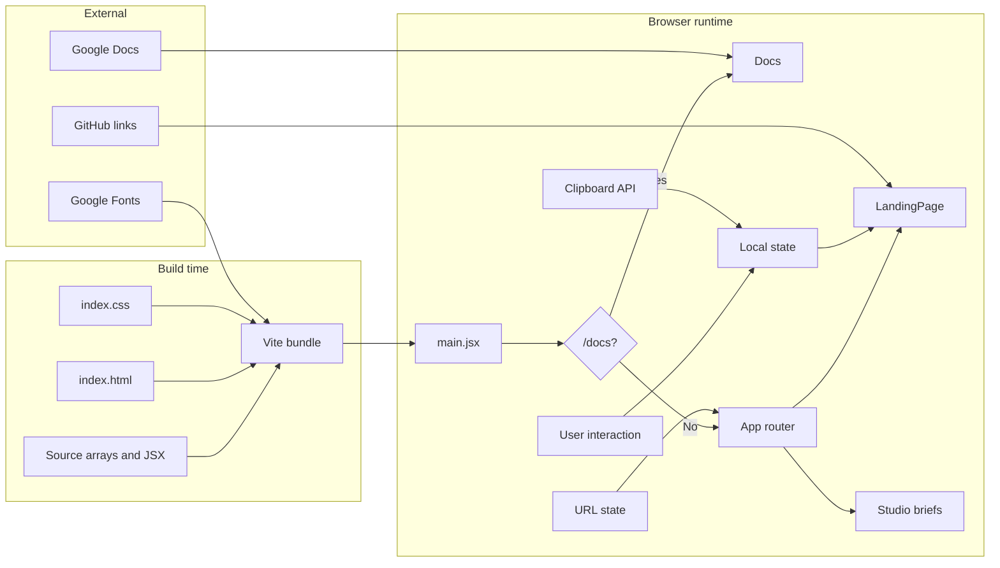
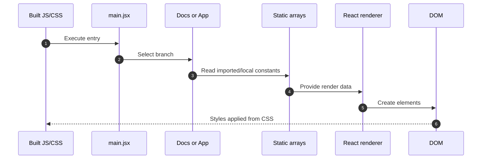
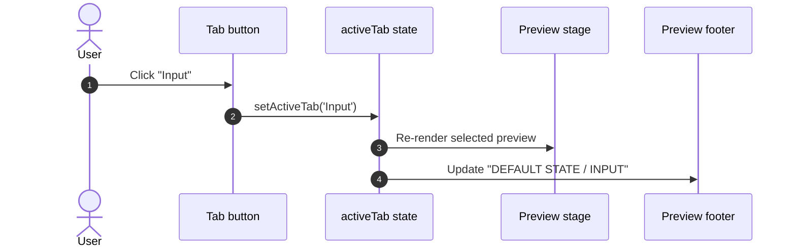
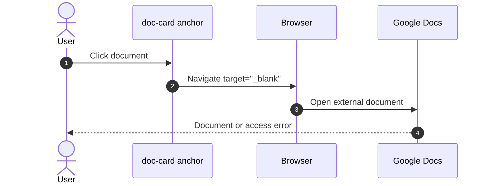
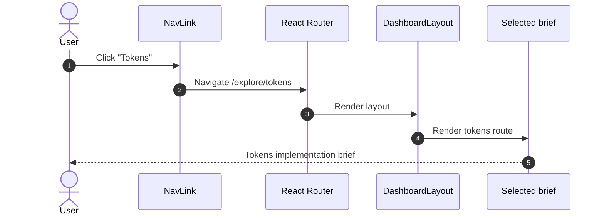
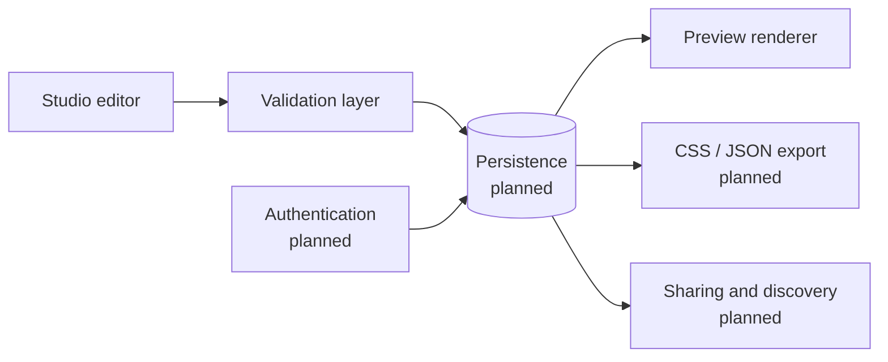

# Data Flow

## Purpose

This document explains where data comes from, how it moves through the current Atria application, and
what is deliberately absent. It covers static content, URL state, local component state, clipboard
interaction, external links, and the planned future data model.

The key fact is simple: **Atria has no backend and no persistence today.** All product content is
compiled into the frontend bundle.

---

## 1. Data sources

| Source | Location | Type | Mutability |
|---|---|---|---|
| Foundation cards | `src/App.jsx` `foundations` | Static array of objects | Build-time |
| Palette swatches | `src/App.jsx` `swatches` | Static array of hex strings | Build-time |
| Playground tabs | `src/App.jsx` JSX literal | Static array of names | Build-time |
| Documentation collections | `src/Docs.jsx` `groups` | Static nested array | Build-time |
| Foundations brief tasks | `src/pages/Foundations.jsx` `tasks` | Static array | Build-time |
| Tokens brief stages | `src/pages/Tokens.jsx` `stages` | Static array | Build-time |
| Components brief parts | `src/pages/Components.jsx` `componentParts` | Static array of tuples | Build-time |
| Studio navigation | `src/layouts/DashboardLayout.jsx` `sections` | Static array | Build-time |
| Current route | Browser URL / React Router | Runtime | User navigation |
| Playground selection | React `useState` | Runtime | User click |
| Copy feedback | React `useState` | Runtime | Clipboard promise |
| Clipboard content | Hard-coded literal in `copyToken` | Runtime write | Clipboard API |
| External documents | Google Docs URLs | External | Managed outside this repository |
| Fonts | Google Fonts URLs in `index.html` | External | Loaded by browser |

---

## 2. High-level flow



---

## 3. Render pipeline



There is no asynchronous data loading. The first render has all the data it needs.

---

## 4. Interaction flows

### 4.1 Playground tab switch



Flow facts:

- The three tabs are local literals: `Button`, `Input`, `Badge`.
- Selected tab receives the `selected` class.
- Only one preview is rendered at a time.
- No component code is loaded, executed, or exported.

### 4.2 Copy token

```mermaid
sequenceDiagram
  autonumber
  actor User
  participant Button as Copy button
  participant Handler as copyToken
  participant Clipboard as navigator.clipboard
  participant State as copied state

  User->>Button: Click copy
  Button->>Handler: Invoke copyToken
  Handler->>Clipboard: writeText('--atria-space-4: 16px;')
  alt Clipboard resolves
    Clipboard-->>Handler: Success
    Handler->>State: setCopied(true)
    State-->>Button: Label becomes COPIED
    Handler->>Handler: setTimeout 1800 ms
    Handler->>State: setCopied(false)
  else Clipboard rejects
    Clipboard-->>Handler: Error
    Handler->>State: setCopied(false)
  end
```

Flow facts:

- The copied value is a literal string, not generated from a token model.
- The button label returns to `COPY` after 1.8 seconds.
- Errors are swallowed intentionally; no error toast is shown.
- The operation requires a secure context and clipboard permission in most browsers.

### 4.3 Documentation card click



Flow facts:

- All cards use `target="_blank"` and `rel="noreferrer"`.
- The destination is managed outside the repository.
- Atria does not fetch or render document content itself.

### 4.4 Studio navigation



Flow facts:

- Active styling is derived from the current URL through `NavLink`.
- Navigation is client-side within the router.
- `/docs` is not part of this router; visiting it triggers a full page load.

---

## 5. State ownership

| State | Owner | Derived from | Lifetime |
|---|---|---|---|
| Route | React Router | Browser URL | Until navigation |
| `activeTab` | `LandingPage` | User action | Until unmount |
| `copied` | `LandingPage` | Clipboard promise | Until timer or unmount |
| Active sidebar item | `NavLink` | Route | Until navigation |

No state is shared across pages. Navigation resets `LandingPage` state because the component unmounts.

---

## 6. What is not present

The following data flows do **not** exist:

- HTTP requests from the app to an API.
- Server-side rendering or data loaders.
- Database reads or writes.
- Authentication tokens or session state.
- User profiles or ownership metadata.
- File uploads or downloads.
- Token generation, validation, or export.
- Component execution or preview isolation.
- Analytics or telemetry.
- Browser storage of design-system data.

This is important for reviewers: any documentation that implies these flows exists is inaccurate.

---

## 7. Planned future data flow

The Studio briefs describe a future model. The following diagram is **planned only** and must not be
read as implemented.



### Proposed model direction from the briefs

**Tokens**

- stable ID;
- name;
- category;
- value;
- type;
- description;
- primitive or semantic classification;
- references between semantic and primitive tokens;
- validation for names, formats, missing references, and circular references;
- CSS custom property and JSON exports.

**Foundations**

- colour values and meaningful names;
- light and dark theme previews;
- accessible foreground/background pairings;
- type families, weights, sizes, and line heights;
- spacing, sizing, grid, container, radius, and elevation conventions where needed.

**Components**

- name, description, category, creator, version, and tags;
- props and slots;
- variants and states;
- isolated previews;
- usage and accessibility guidance;
- create → preview → publish → discover → reuse flow.

These are contributor directions, not current capabilities.

---

## 8. Related documents

- [System architecture](system-architecture.md)
- [High-level design](high-level-design.md)
- [Low-level design](low-level-design.md)
- [State management](../engineering/state-management.md)
- [Application workflows](../engineering/application-workflows.md)
- [Design tokens feature](../features/design-tokens.md)
