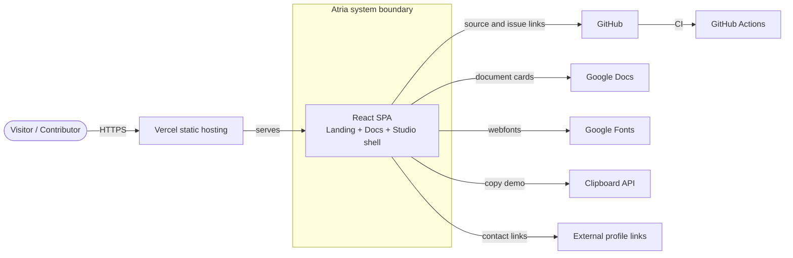
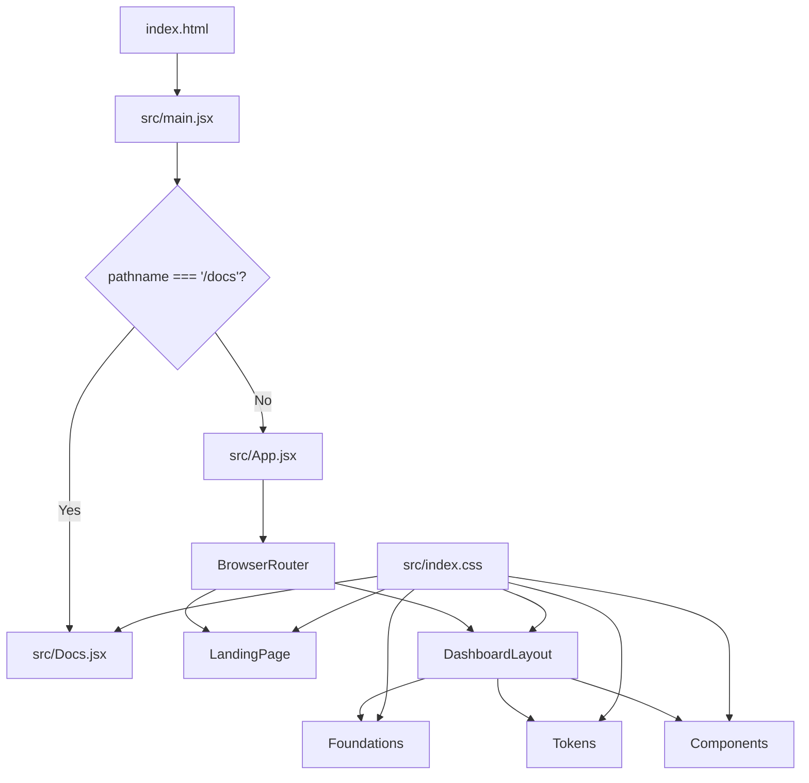
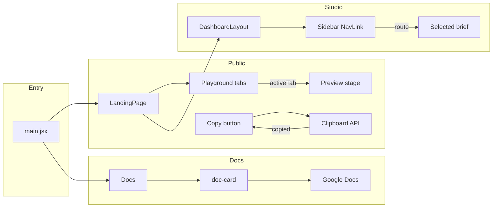
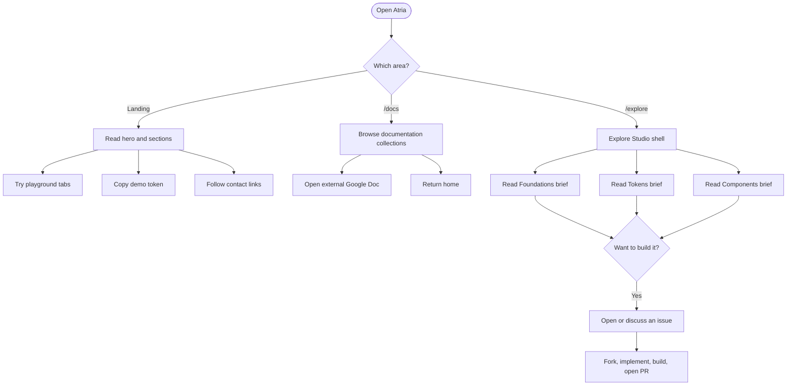
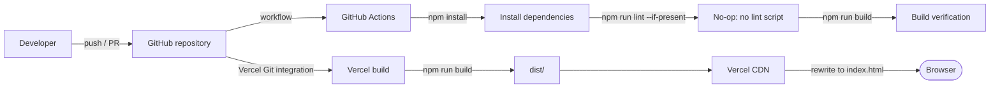

# Architecture Diagrams

This page collects the primary architecture diagrams in one place. All diagrams use Mermaid and
describe the implementation in this repository. Planned capabilities are labelled.

---

## 1. System context diagram

Shows the system boundary, actors, static hosting, and external services.



**Notes**

- One deployable unit: the static SPA.
- No backend, API, database, authentication, or persistence.
- Google Docs and Google Fonts are external dependencies.

---

## 2. Application architecture diagram

Shows entry branching and route composition.



**Notes**

- `Docs` is outside React Router.
- `DashboardLayout` wraps the three Studio briefs through an `Outlet`.

---

## 3. Component interaction diagram

Shows interaction between UI components and local state.



**Notes**

- `activeTab` and `copied` are local to `LandingPage`.
- The sidebar active state is derived from the current route.

---

## 4. Data flow diagram

Shows static content, URL state, local state, and external links.

```mermaid
flowchart LR
  Arrays[Static arrays<br/>foundations, swatches, groups, briefs] --> Render[React render]
  Route[URL / router state] --> Render
  Local[Local useState] --> Render
  Click[User interaction] --> Local
  Click --> Clipboard[Clipboard API]
  Render --> DOM[Rendered UI]
  DocsURLs[Google Docs URLs] --> DocCards[/docs cards]
  FontURLs[Google Fonts URLs] --> Browser[Browser font loading]
```

**Notes**

- No API, database, or persistence.
- The only runtime write is the hard-coded token string copied to the clipboard.

---

## 5. Application workflow diagram

Shows the main user journeys.



**Notes**

- Studio sections are informational today.
- Contribution is the intended next step after reading a brief.

---

## 6. Deployment architecture diagram

Shows source control, CI verification, and Vercel hosting.



**Notes**

- GitHub Actions verifies the build; it does not deploy.
- Vercel handles the production build and static hosting.
- All paths rewrite to `index.html` so client routes work on refresh.

---

## Diagram maintenance

When the architecture changes:

1. Update the relevant diagram in this file.
2. Update the matching detailed document.
3. Add or update an ADR if the decision is structural.
4. Confirm the diagram does not claim unbuilt functionality.
5. Check that Mermaid renders in GitHub and your editor.

---

## Related documents

- [System architecture](system-architecture.md)
- [High-level design](high-level-design.md)
- [Low-level design](low-level-design.md)
- [Component architecture](component-architecture.md)
- [Data flow](data-flow.md)
- [Deployment](../deployment/build-and-deployment.md)
