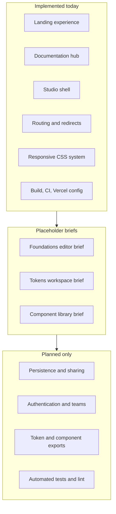
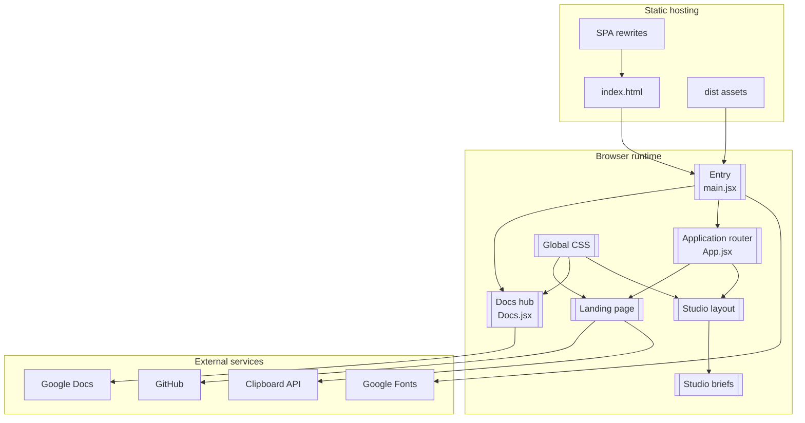
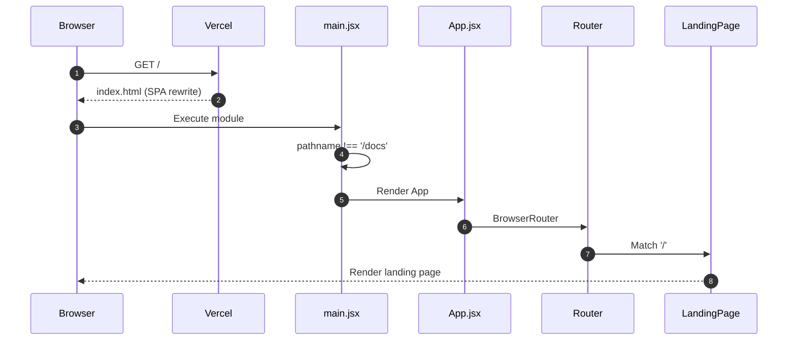
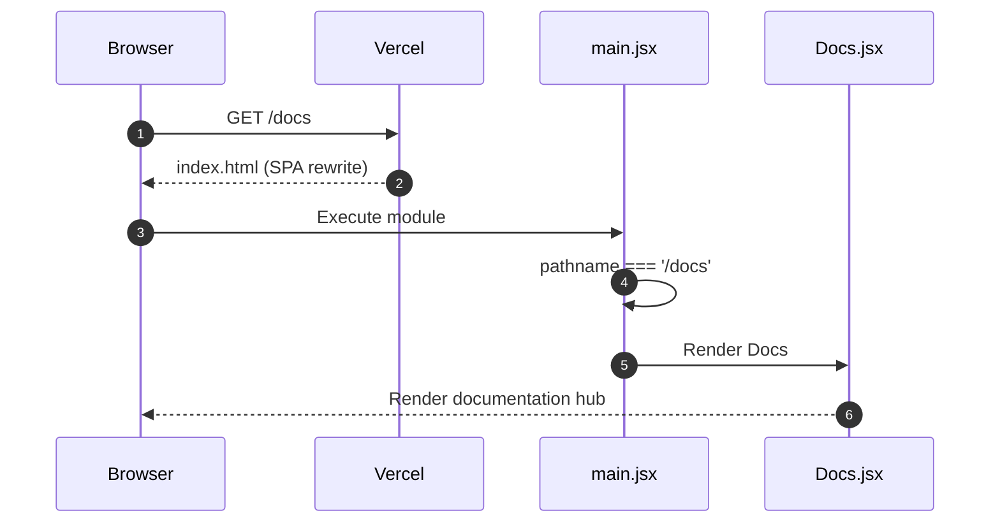
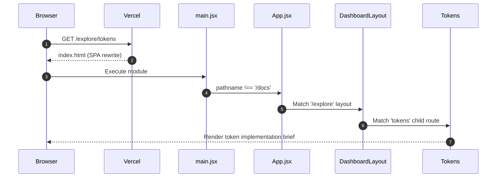
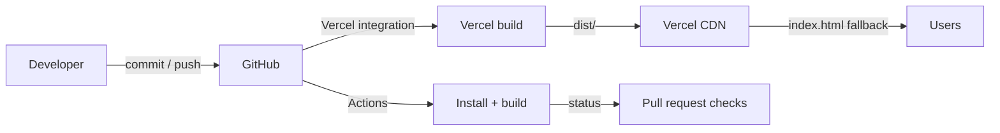

# High-Level Design

## 1. Purpose

The High-Level Design (HLD) explains Atria at the level of actors, capabilities, containers, and
lifecycle. It answers:

- Who uses the system?
- What can they do today?
- What are the major logical containers?
- How does a request become a rendered page?
- Which capabilities are implemented, placeholders, or planned?
- How can the system evolve without breaking its current boundaries?

For file-level detail, read the [Low-Level Design](low-level-design.md).

---

## 2. Goals and non-goals

### Goals of the current implementation

1. Present Atria's product idea through a polished, responsive landing page.
2. Provide a browsable documentation hub for product, design, and engineering material.
3. Establish a navigable Explore Studio shell for future design-system work.
4. Make the next contribution surface explicit through implementation briefs.
5. Keep the codebase small, readable, and easy to run.
6. Deploy as a static single-page application with reliable route fallback.
7. Verify every change with a production build in CI.

### Non-goals of the current implementation

- Persisting design systems or user data.
- Allowing users to create, edit, or export tokens.
- Running or publishing components.
- Authenticating users or protecting private workspaces.
- Providing a public API.
- Supporting server-side rendering.
- Automated test coverage or lint enforcement.

These non-goals are deliberate. Documenting them prevents false expectations.

---

## 3. Actors and needs

```mermaid
flowchart LR
  Visitor[Visitor] -->|learns about Atria| Landing[Landing page]
  Reader[Documentation reader] -->|browses documents| Docs[/docs hub]
  Explorer[Studio explorer] -->|reads implementation briefs| Studio[/explore shell]
  Contributor[Contributor] -->|clones, edits, builds| Repo[Source repository]
  Reviewer[Reviewer] -->|inspects diff and checks build| Repo
  Maintainer[Maintainer] -->|merges and manages releases| Repo
```

| Actor | Primary need | Current support |
|---|---|---|
| Visitor | Understand the product and visual language | Implemented landing page |
| Documentation reader | Find product and design context | Implemented `/docs` hub with outbound documents |
| Studio explorer | Understand the intended Studio capabilities | Implemented briefs, not editors |
| Contributor | Set up, navigate, and extend the codebase | Implemented setup and documentation; no tests or linter |
| Reviewer | Assess scope, accuracy, and build health | Build CI and PR checklist; no automated tests |
| Maintainer | Preserve architecture and documentation quality | ADRs, status labels, and documentation rules |

---

## 4. Capability map



### Implemented capabilities

| Capability | User-visible behaviour | Implementation |
|---|---|---|
| Landing experience | Hero, preview panel, ticker, foundation cards, playground, token demo, contact | `LandingPage` in `src/App.jsx` |
| Documentation hub | Three collections, six outbound document cards | `src/Docs.jsx` |
| Studio shell | Header, sticky sidebar, nested outlet, footer | `src/layouts/DashboardLayout.jsx` |
| Routing and redirects | `/`, `/explore/*`, `/docs`, `/studio/*`, catch-all | `src/main.jsx`, `src/App.jsx` |
| Responsive CSS system | Five breakpoints, reduced-motion support | `src/index.css` |
| Build and deployment | Vite build, GitHub Actions, Vercel rewrites | `package.json`, CI, `vercel.json` |

### Placeholder capabilities

The three Studio pages contain structured guidance for contributors. They do not contain forms,
editors, previews, persistence, or export actions.

- Foundations: colour, typography, spacing and layout.
- Tokens: token structure, groups and references, edit/validate/export.
- Components: anatomy and API, variants and states, live preview, usage and accessibility, share and
  reuse.

### Planned capabilities

- A storage and sharing model for design-system data.
- Authentication and team workspaces.
- Export generation for CSS variables and JSON.
- Component execution and preview isolation.
- Automated testing and linting.
- Additional documentation formats.

---

## 5. Logical containers

Atria has one deployable container: a static frontend bundle.



### Container responsibilities

| Container | Responsibility | Technology |
|---|---|---|
| Static hosting | Serve HTML, JS, CSS, and assets with route fallback | Vercel |
| HTML shell | Metadata, fonts, root element, module entry | `index.html` |
| Entry module | Select Docs or App and mount React | `src/main.jsx` |
| Documentation hub | Render document collections and outbound links | React |
| Application router | Match routes, redirect, and render pages | React Router 7 |
| Landing page | Marketing and demonstration experience | React |
| Studio shell | Persistent navigation and shared layout | React |
| Studio briefs | Contributor guidance | React |
| Global stylesheet | All visual and responsive rules | CSS |
| External services | Documents, source, fonts, clipboard | Third-party / browser |

---

## 6. Request lifecycle

### 6.1 Loading `/`



### 6.2 Loading `/docs`



### 6.3 Loading `/explore/tokens`



### 6.4 Redirect lifecycle

- `/explore` renders the layout with an index route that redirects to `foundations`.
- `/studio/*` redirects to `/explore`.
- Unknown routes redirect to `/`.
- Redirects use React Router's `<Navigate replace />`.

---

## 7. Navigation model

```mermaid
flowchart LR
  Home[/] -->|Explore the studio| Explore[/explore/foundations]
  Home -->|Docs| Docs[/docs]
  Home -->|Repo CTA| GitHub[GitHub]
  Explore -->|Sidebar| Foundations[/explore/foundations]
  Explore -->|Sidebar| Tokens[/explore/tokens]
  Explore -->|Sidebar| Components[/explore/components]
  Docs -->|Back to Atria| Home
  Docs -->|Document cards| GoogleDocs[Google Docs]
```

| Navigation | Mechanism | Notes |
|---|---|---|
| Landing internal anchors | Native hash links | `#studio`, `#foundations`, `#components`, `#contact` |
| Landing to Studio | Native anchor to `/explore` | Full navigation into the SPA route |
| Landing to docs | Native anchor to `/docs` | Full page load because Docs is outside the router |
| Studio sidebar | React Router `NavLink` | Active state handled by the router |
| Studio to home | Native anchor to `/` | Full navigation |
| Docs to home | Native anchor to `/` | Full navigation |
| Docs cards | External anchor with `target="_blank"` | Opens Google Docs |

---

## 8. Failure modes

| Failure | Current behaviour | User impact |
|---|---|---|
| Unknown route | Redirect to `/` | User is sent home |
| `/docs/` trailing slash | App router catch-all redirects to `/` | Documentation hub not shown |
| Clipboard denied | `catch` resets `copied` to `false` | No false success message |
| Google Fonts unavailable | Browser fallback fonts | Visual change, still usable |
| Google Docs unavailable/private | External page fails to load | Documentation reader sees external error |
| Build error | CI fails and Vercel build fails | Deployment is blocked |
| Runtime rendering error | No error boundary; React default behaviour | Page may go blank |
| API failure | Not applicable; no API exists | Not applicable |

---

## 9. Deployment view



The CI workflow is a verification gate, not a deployment mechanism. Vercel's Git integration performs
the production build and serves the static output. The rewrite rule ensures client-side routes resolve
to `index.html`.

---

## 10. Evolution strategy

The current HLD is intentionally minimal. Future work should extend it in layers:

### Layer 1 — Domain schemas

Define stable models for:

- foundation values (colour, typography, spacing);
- tokens (ID, name, category, value, type, description, references);
- component entries (name, description, category, creator, version, tags, preview, props, states).

### Layer 2 — Local editing

Add forms, validation, previews, and local persistence. Keep the frontend as the source of truth until
sharing is required.

### Layer 3 — Export

Generate CSS custom properties and JSON from validated token models. Exports should be deterministic
and covered by tests.

### Layer 4 — Shared persistence

Introduce an API and database only when multiple users need the same data. This requires:

- authentication and authorisation;
- data ownership and migration strategy;
- API contracts and error handling;
- audit and versioning.

### Layer 5 — Community features

Publishing, discovery, reuse, and team workspaces. These require moderation, permissions, and
operational tooling.

Each layer should have ADRs, documentation updates, and tests.

---

## 11. Related documents

- [System architecture](system-architecture.md)
- [Low-level design](low-level-design.md)
- [Architecture diagrams](diagrams.md)
- [Application workflows](../engineering/application-workflows.md)
- [Feature overview](../features/README.md)
- [Roadmap](../../README.md#roadmap)
