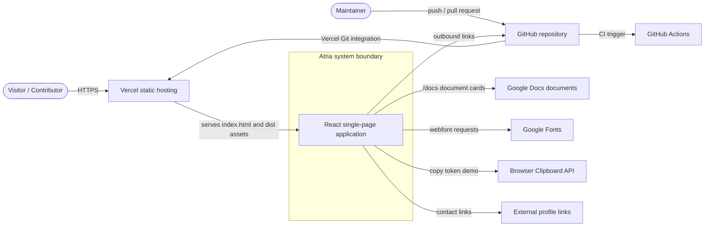
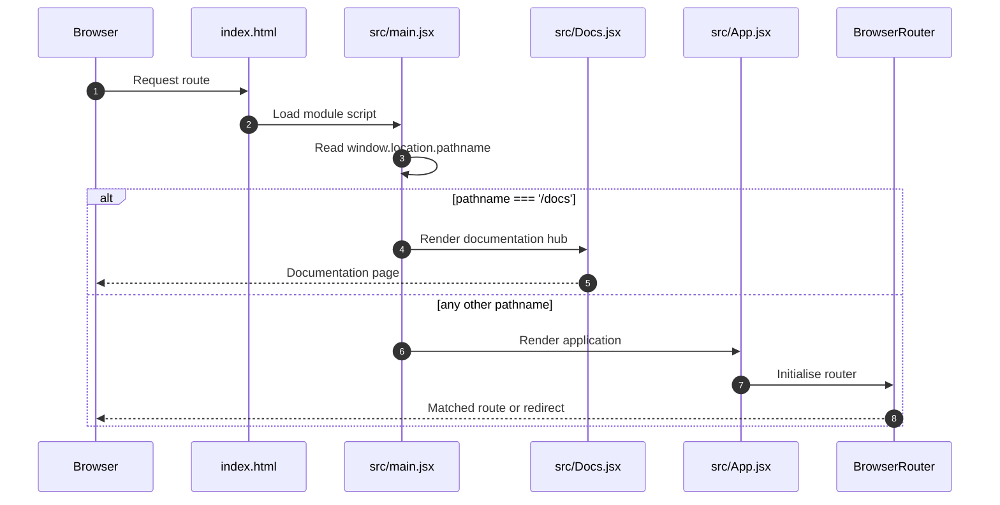
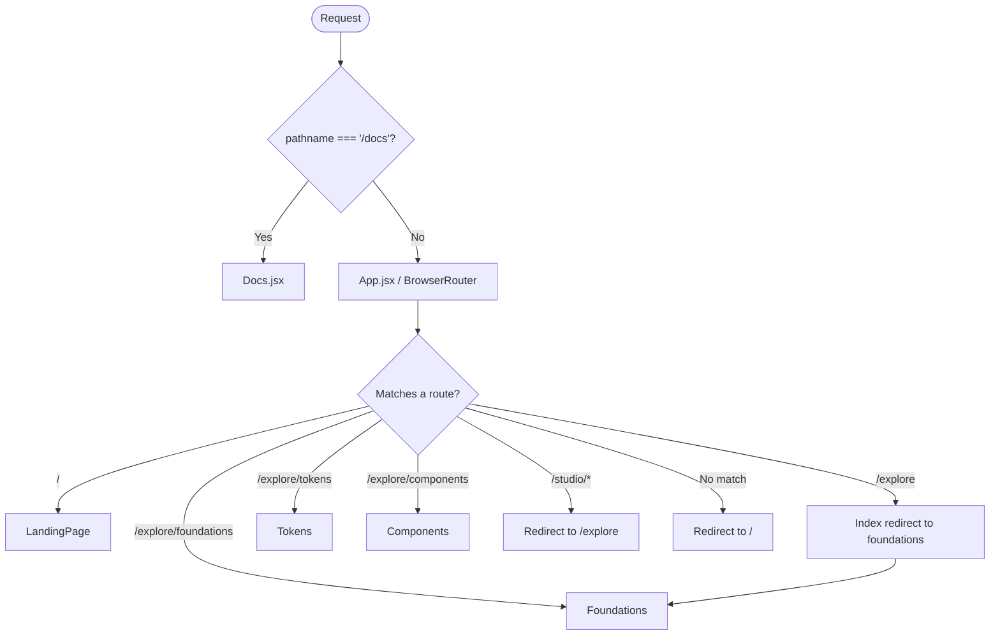
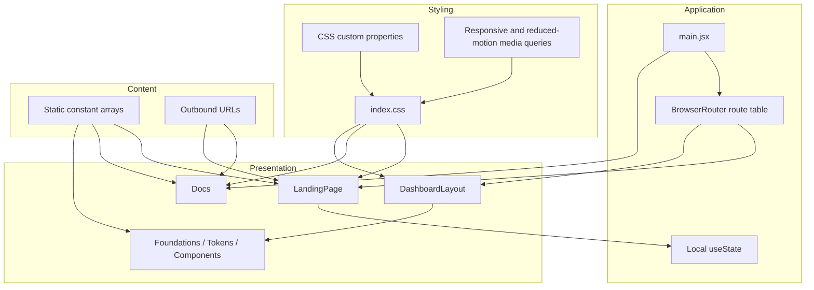
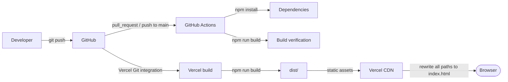

# System Architecture

## Purpose

This document describes the architecture of Atria as implemented in this repository. It covers the
system boundary, runtime model, rendering strategy, routing topology, styling architecture, external
integrations, deployment model, and current constraints.

It is not a product roadmap. Planned capabilities are called out explicitly and never described as
complete.

---

## 1. System scope

Atria is an open-source design system studio. The repository currently delivers the frontend
experience:

- a public marketing and demonstration page;
- a documentation hub;
- an Explore Studio navigation shell;
- static implementation briefs for Foundations, Tokens, and Components;
- a responsive CSS design language;
- build, CI, and hosting configuration.

The repository does **not** contain:

- a backend service or server application;
- a database, ORM, schema, or migrations;
- authentication or user accounts;
- persistent storage for foundations, tokens, or components;
- token export generation;
- automated tests or linters.

These absences are architectural facts, not omissions in the documentation.

---

## 2. System context



### Actors

| Actor | Interaction |
|---|---|
| Visitor | Browses the landing page, tries the component playground, copies the demo token, and follows links |
| Documentation reader | Opens `/docs` and follows outbound document cards |
| Studio explorer | Opens `/explore/*` and reads the implementation briefs |
| Contributor | Clones the repository, runs the app, edits source, builds, and opens pull requests |
| Maintainer | Reviews changes, merges to `main`, and manages issues and releases |
| CI system | Installs dependencies and verifies the production build |

### External systems

| System | Direction | Purpose | Failure behaviour |
|---|---|---|---|
| Vercel | Response | Static hosting and SPA rewrites | Site unavailable if hosting fails |
| GitHub | Outbound links + source hosting | Repository, issues, star CTA | Links fail if GitHub is unreachable |
| GitHub Actions | Inbound trigger | Build verification | CI status fails or is unavailable |
| Google Docs | Outbound links | Product, design, and engineering documents | External docs may be unavailable or private |
| Google Fonts | Outbound request | Manrope and DM Mono webfonts | Falls back to system fonts; layout remains usable |
| Clipboard API | Browser API | Copy demo token | `try/catch` resets the label without copying |

---

## 3. Runtime architecture

### 3.1 Entry sequence



### 3.2 Two entry branches

`src/main.jsx` mounts exactly one of two trees:

```jsx
{window.location.pathname === '/docs' ? <Docs /> : <App />}
```

- **`/docs` branch:** renders `src/Docs.jsx` directly. This bypasses React Router.
- **All other paths:** renders `src/App.jsx`, which creates a `BrowserRouter` and matches routes.

This design keeps the documentation hub independent from the Studio application router. The tradeoff
is that `/docs` is not a React Router route, and navigations to it use full page loads. The exact
match also means `/docs/` (with a trailing slash) is not handled by this branch; it falls into the
application router and then the catch-all redirect to `/`. This behaviour is documented in
[Routing](../engineering/routing.md) and [ADR-0003](adr/0003-docs-outside-router.md).

### 3.3 Rendering model

| Property | Current implementation |
|---|---|
| Rendering | Client-side only |
| SSR / SSG | None |
| Hydration | None |
| Data fetching | None |
| Global state | None |
| Persistence | None |
| Routing | React Router 7 for the app; pathname branch for `/docs` |
| Styling | Global CSS with CSS custom properties |
| Animation | CSS transitions and media-query-controlled motion |

The app is a static bundle. All content is embedded in JavaScript modules at build time.

### 3.4 Route topology



---

## 4. Logical architecture



There is no service layer, repository layer, domain model, or data access layer. Introducing those
without a persistence requirement would add complexity without product value.

---

## 5. Component boundaries

| Component | File | Owns | Does not own |
|---|---|---|---|
| Entry | `src/main.jsx` | Choosing Docs vs App, mounting root | Routing rules, page content |
| Application router | `src/App.jsx` | Route table, landing page, redirects | Studio layout internals |
| Landing page | `src/App.jsx` (`LandingPage`) | Hero, ticker, cards, playground, token demo, contact | Studio navigation, documentation cards |
| Documentation hub | `src/Docs.jsx` | Document collections and outbound cards | App routing, Studio shell |
| Studio layout | `src/layouts/DashboardLayout.jsx` | Header, sidebar, footer, outlet | Section content |
| Foundations brief | `src/pages/Foundations.jsx` | Static foundation guidance | Editing, persistence, tokens |
| Tokens brief | `src/pages/Tokens.jsx` | Static token guidance | Token CRUD, validation, export |
| Components brief | `src/pages/Components.jsx` | Static component guidance | Component registry, preview runtime |
| Styling | `src/index.css` | Entire visual system and responsive rules | Runtime data, routing |

Read [Component architecture](component-architecture.md) for the full tree and coupling notes.

---

## 6. Styling architecture

Atria uses a single global stylesheet, `src/index.css`. There is no Tailwind, CSS Modules,
CSS-in-JS, Sass, or PostCSS pipeline.

### Design tokens in CSS

```css
:root {
  --paper: #f7f7f5;
  --ink: #20201e;
  --muted: #85837d;
  --line: #deddd8;
  --mono: 'DM Mono', monospace;
}
```

The palette also uses literal values such as `#eeede9`, `#242420`, `#8b9d79`, and `#a8b79a`.
These are documented in [Styling and design tokens](../engineering/styling-and-design-tokens.md).

### Responsive model

The stylesheet defines breakpoints at:

- `850px` — landing hero, foundation grid, component layout adjustments;
- `800px` — Explore workspace column width;
- `700px` — documentation hub layout;
- `650px` — Explore mobile navigation and workspace stacking;
- `600px` — landing, foundation cards, component preview, token strip, footer, contact.

### Motion

Transitions are used for hover states, buttons, cards, and links. A
`prefers-reduced-motion: reduce` media query reduces animation and transition durations to `0.01ms`
and disables smooth scrolling.

### Typography

`index.html` loads Manrope (400–800) and DM Mono (400, 500) from Google Fonts. The CSS sets Manrope as
the root font and DM Mono through `--mono`. Headings use Georgia for italic emphasis.

---

## 7. Data architecture

### Sources

| Source | Location | Nature |
|---|---|---|
| Foundation cards | `src/App.jsx` `foundations` array | Static in-memory array |
| Palette swatches | `src/App.jsx` `swatches` array | Static hex values |
| Playground tabs | `src/App.jsx` local literal array | Static tab names |
| Documentation collections | `src/Docs.jsx` `groups` array | Static metadata and Google Docs URLs |
| Foundations brief tasks | `src/pages/Foundations.jsx` `tasks` array | Static guidance |
| Tokens brief stages | `src/pages/Tokens.jsx` `stages` array | Static guidance |
| Components brief parts | `src/pages/Components.jsx` `componentParts` array | Static guidance |
| Studio navigation | `src/layouts/DashboardLayout.jsx` `sections` array | Static routes and icons |

### No persistence

No browser storage (`localStorage`, `sessionStorage`, IndexedDB), cookies, API calls, or server
requests are used. Refreshing the page resets all local state.

### Clipboard

The only browser data write is `navigator.clipboard.writeText('--atria-space-4: 16px;')` in the
landing page token demo. It is wrapped in `try/catch`; on failure the UI does not claim success.

Read [Data flow](data-flow.md) for interaction sequence diagrams.

---

## 8. Deployment architecture



- `vercel.json` sets `framework` to `vite`, `buildCommand` to `npm run build`, `outputDirectory` to
  `dist`, and rewrites every path to `/index.html`.
- `.github/workflows/ci.yml` runs on pushes and pull requests to `main` using Node.js 20, runs
  `npm install`, optionally `npm run lint --if-present`, and `npm run build`.
- CI does not deploy. Deployment is handled through Vercel.
- The live site responds at `https://atriastudio.vercel.app`, and `/explore` and `/docs` return the
  SPA shell via rewrites.

Read [Build and deployment](../deployment/build-and-deployment.md) for operational detail.

---

## 9. Quality attributes

### Performance

- Static assets served by Vercel CDN.
- 4,587 modules transformed in the verified production build.
- Verified build output: approximately 359 kB JavaScript (107 kB gzip) and 22 kB CSS (5 kB gzip).
- No code splitting, image pipeline, or runtime data fetching.
- Phosphor Icons and Google Fonts are the main external costs.

The bundle is acceptable for the current surface but should be revisited as Studio features grow.
See [Performance](../engineering/performance.md).

### Accessibility

Present:

- semantic landmarks (`main`, `nav`, `section`, `aside`, `header`, `footer`);
- labelled navigation regions;
- `aria-label` on the copy-token button;
- `focus-visible` treatment on documentation cards;
- `prefers-reduced-motion` support;
- descriptive link text on outbound document cards.

Gaps:

- no automated accessibility tests;
- colour contrast has not been formally audited;
- some decorative iconography relies on library defaults;
- keyboard interaction exists for buttons and links but has not been exhaustively tested.

See [Accessibility](../quality/accessibility.md).

### Maintainability

Strengths:

- small number of source files;
- clear route table;
- static content easy to edit;
- consistent visual language;
- documented status of placeholders.

Weaknesses:

- global CSS file grows with every feature;
- repeated brand/footer markup across landing, docs, and Studio layout;
- `App.jsx` contains both the landing page and route configuration;
- no automated tests;
- no linter or formatter configuration;
- no shared data or persistence model for Studio sections.

### Security

- client-only, no auth, no secrets, no server;
- external links use `rel="noreferrer"` where they open a new tab;
- clipboard permission is user-initiated;
- dependency surface is small;
- no supply-chain automation beyond Dependabot if enabled by the repository owner (not configured in
  this repository's workflow files).

See [Security and authentication](../engineering/security-and-authentication.md) and
[SECURITY.md](../../SECURITY.md).

---

## 10. Constraints and non-goals

### Current constraints

1. `/docs` bypasses React Router and therefore behaves differently from other routes.
2. All content is hard-coded; content updates require code changes.
3. The Studio pages describe future work rather than providing it.
4. There is no shared brand/footer component, so visual changes may require multiple edits.
5. Automated quality gates are limited to a production build.

### Non-goals for the current architecture

- Server-side rendering or static site generation.
- A backend API or database.
- Multi-user collaboration.
- Authentication and authorisation.
- Component execution sandboxing.
- A token export engine.

These are valid future directions, but they are not part of the current implementation and must not be
documented as delivered.

---

## 11. Evolution path

Any future persistence or collaboration feature will need a deliberate architecture change. The
recommended sequence, based only on the current product briefs, is:

1. Define stable data schemas for foundations, tokens, and components.
2. Implement local editing and validation with in-memory or browser-local persistence.
3. Add export generation for CSS custom properties and JSON.
4. Introduce a backend API and database only when sharing across users is required.
5. Add authentication and authorisation when user-owned data exists.
6. Add automated unit, integration, and accessibility tests alongside each functional area.

Each step should have its own ADR and documentation update.

---

## 12. Verification

The architecture described here was verified against:

- `src/main.jsx`, `src/App.jsx`, `src/Docs.jsx`, `src/layouts/DashboardLayout.jsx`;
- `src/pages/Foundations.jsx`, `src/pages/Tokens.jsx`, `src/pages/Components.jsx`;
- `src/index.css`, `index.html`, `vite.config.js`, `vercel.json`;
- `package.json`, `package-lock.json`, `.github/workflows/ci.yml`;
- a successful `npm run build`;
- live responses from `https://atriastudio.vercel.app`, `/explore`, and `/docs`.

---

## Related documents

- [High-level design](high-level-design.md)
- [Low-level design](low-level-design.md)
- [Component architecture](component-architecture.md)
- [Data flow](data-flow.md)
- [Diagrams](diagrams.md)
- [Architecture decisions](architecture-decisions.md)
- [Frontend architecture](../engineering/frontend-architecture.md)
- [Routing](../engineering/routing.md)
- [Deployment](../deployment/build-and-deployment.md)
