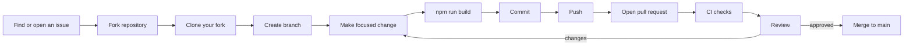

# Contribution Workflow

## 1. Overview

Atria accepts contributions through forks and pull requests. The maintainer reviews changes before
merging to `main`.



---

## 2. Find or open an issue

- Check the issue tracker first.
- For bugs, include steps to reproduce, expected behaviour, actual behaviour, and environment.
- For features, describe the problem and proposed scope.
- For large changes or new dependencies, discuss first.
- Do not start a large implementation without agreement on scope.

Issue tracker: https://github.com/breeze-sn/Atria/issues

---

## 3. Fork the repository

Use GitHub's **Fork** button, then clone your fork:

```bash
git clone https://github.com/<your-username>/Atria.git
cd Atria
```

Add the upstream remote:

```bash
git remote add upstream https://github.com/breeze-sn/Atria.git
```

---

## 4. Install dependencies

```bash
npm install
```

Use Node.js 20 or newer. No environment variables are required.

Verify the app:

```bash
npm run dev
```

Verify the build:

```bash
npm run build
```

---

## 5. Create a branch

Branch from an up-to-date `main`:

```bash
git checkout main
git pull upstream main
git checkout -b docs/readme-redesign
```

Suggested prefixes:

| Prefix | Use |
|---|---|
| `docs/` | Documentation |
| `feat/` | New functionality |
| `fix/` | Bug fix |
| `refactor/` | Internal restructuring |
| `test/` | Tests |
| `chore/` | Tooling or maintenance |

Keep the branch focused on one change.

---

## 6. Make the change

Guidelines:

- Match the surrounding code style.
- Keep the change small enough to review.
- Do not reformat unrelated files.
- Update documentation in the same branch.
- Do not introduce a dependency without justification.
- Do not claim unimplemented features.
- Do not add secrets.

Useful references:

- [Frontend architecture](../engineering/frontend-architecture.md)
- [Coding standards](../quality/coding-standards.md)
- [Feature overview](../features/README.md)
- [Documentation guidelines](documentation-guidelines.md)

---

## 7. Verify

Minimum:

```bash
npm run build
```

Then run the relevant manual checks from
[Testing strategy](../quality/testing-strategy.md).

For UI changes:

- check desktop and mobile;
- check keyboard access;
- check reduced motion;
- capture screenshots if the public visual changed.

For documentation changes:

- check every link;
- check anchors;
- confirm status labels;
- confirm Mermaid renders.

---

## 8. Commit

Recommended format:

```text
type: short imperative summary

Optional body explaining why the change is needed and any tradeoffs.
```

Examples:

```text
docs: redesign README and expand documentation library
fix: handle clipboard denial without false success
feat: add token group navigation
```

Rules:

- Use imperative mood.
- Keep the subject concise.
- Explain the why in the body when needed.
- Do not mix unrelated changes.
- Do not commit `node_modules/` or `dist/`.

---

## 9. Push your branch

```bash
git push origin docs/readme-redesign
```

---

## 10. Open a pull request

Target `main` on `breeze-sn/Atria`.

Use the repository pull request template. Include:

- what changed;
- why it changed;
- how it was verified;
- screenshots for visual changes;
- documentation updates;
- any follow-up work.

Read [Pull request guidelines](pull-request-guidelines.md) for the exact format.

---

## 11. Respond to review

- Address each comment or explain why not.
- Push follow-up commits to the same branch.
- Keep the discussion focused.
- Re-run the build after changes.
- Do not force-push over review history unless asked.

---

## 12. Keep your branch up to date

```bash
git fetch upstream
git checkout main
git merge upstream/main
git checkout docs/readme-redesign
git rebase main
```

Resolve conflicts carefully. If you rebase after pushing, you may need `git push --force-with-lease`.

For shared branches, prefer merging over rebasing to avoid disrupting review history.

---

## 13. After merge

- Delete your remote branch if it is no longer needed.
- Update your local `main`:

```bash
git checkout main
git pull upstream main
```

- Thank the reviewers.

---

## 14. Documentation-only contributions

Documentation is a first-class contribution. For docs-only changes:

1. Follow [Documentation guidelines](documentation-guidelines.md).
2. Link from the relevant index.
3. Verify every relative path.
4. Do not add screenshots or diagrams that misrepresent the product.
5. Run `npm run build` only if you changed application files; not required for Markdown-only changes,
   but harmless.

---

## 15. Related documents

- [Pull request guidelines](pull-request-guidelines.md)
- [Debugging](debugging.md)
- [Documentation guidelines](documentation-guidelines.md)
- [Testing strategy](../quality/testing-strategy.md)
- [Coding standards](../quality/coding-standards.md)