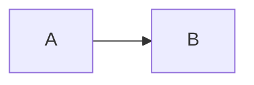

# Documentation Guidelines

## 1. Purpose

Documentation is part of the product. It should help contributors understand the codebase quickly and
trust what they read.

These guidelines exist because Atria is early-stage and it is easy to accidentally describe future
features as if they already work.

---

## 2. Core principles

1. **The code is the source of truth.** Verify against files, configuration, or a running build.
2. **Label status honestly.** Implemented, Placeholder, Planned, or Not implemented.
3. **Prefer concrete detail.** File paths, commands, route tables, and data shapes.
4. **Write for a reader who is new to the repository.**
5. **Keep documents linked and discoverable.**
6. **Update docs in the same change as the code.**
7. **Never document secrets or private endpoints.**

---

## 3. Status labels

Use these consistently:

| Label | Meaning | Example |
|---|---|---|
| **Implemented** | Exists in the code and is user-visible | Landing page |
| **Implemented, limited** | Exists but is a demonstration | Copy token demo |
| **Placeholder** | A brief exists, capability does not | Foundations editor |
| **Planned** | Direction only, nothing built | Token export |
| **Not implemented** | No capability | API, authentication |
| **Not configured** | Tooling is absent | Tests, linting |

Avoid vague phrases such as "coming soon" without a status label.

---

## 4. Accuracy checklist

Before publishing a document:

- [ ] Every file path exists.
- [ ] Every command works.
- [ ] Every route matches the code.
- [ ] Every package version matches `package.json` or the lockfile.
- [ ] Every external URL is reachable.
- [ ] Every relative link resolves.
- [ ] Every anchor resolves.
- [ ] No unimplemented feature is described as complete.
- [ ] No screenshot misrepresents the product.
- [ ] No secret, token, or private contact data is included beyond what is already public in the app.

---

## 5. Linking

### Relative links

Use relative paths inside the repository:

```markdown
[Routing](../engineering/routing.md)
[Installation](../../getting-started/installation.md)
```

Rules:

- Resolve from the current file's directory.
- Include the `.md` extension for clarity in GitHub and editors.
- Match filename casing exactly.
- Avoid absolute filesystem paths.
- Avoid `/docs/...` for repository links; that can be confused with the web route.

### Anchors

- Use GitHub-style slugs: lowercase, hyphens for spaces, punctuation removed.
- Keep headings unique within a file.
- Check anchors after renaming headings.

### External links

- Use full URLs.
- Add context around the link so it makes sense out of context.
- Do not link to private documents in public docs unless access is intended.
- Prefer the canonical project URLs.

---

## 6. Structure

Recommended structure for a substantial document:

```markdown
# Title

## 1. Purpose

## 2. Context / overview

## 3. Details

## 4. Diagrams

## 5. Limitations / gaps

## 6. Related documents
```

For feature documents, include:

- status;
- route or entry point;
- source files;
- what exists;
- what does not exist;
- interactions;
- accessibility notes;
- limitations;
- change guidance.

For architecture documents, include:

- scope and non-goals;
- diagrams;
- boundaries;
- data flow;
- tradeoffs;
- related decisions.

---

## 7. Writing style

- Use clear, direct language.
- Prefer short paragraphs and scannable tables.
- Use present tense for implemented behaviour.
- Use "planned" or "not implemented" for future work.
- Define acronyms on first use.
- Avoid marketing language in engineering docs.
- Avoid first-person voice.
- Keep headings descriptive.

### Good

> The `/docs` page is rendered by a pathname branch in `src/main.jsx`. It is not a React Router route.

### Avoid

> The docs are fully integrated into the app router and support nested pages.

The second sentence is false.

---

## 8. Diagrams

Use Mermaid for architecture, flows, and sequences.

````markdown

````

Guidelines:

- Keep diagrams small and readable.
- Use meaningful node labels.
- Label planned flows explicitly.
- Do not diagram unimplemented behaviour without a label.
- Prefer text tables for simple relationships.
- Verify rendering in GitHub or a Mermaid preview.

---

## 9. Screenshots and assets

- Use real screenshots from the current build.
- Do not fabricate UI concepts and present them as product.
- Store assets in `docs/assets/`.
- Use descriptive filenames.
- Record provenance and regeneration steps in `docs/assets/README.md`.
- Keep file sizes reasonable.
- Provide alt text for every image.
- Update screenshots when the public UI changes.

---

## 10. Code blocks

- Use the correct language fence.
- Keep commands runnable from the repository root unless stated otherwise.
- Do not include placeholder secrets.
- Mark placeholders clearly (`<your-username>`, `<issue-number>`).

---

## 11. Index maintenance

When adding, renaming, or removing a document:

1. Update [`docs/README.md`](../README.md).
2. Update the root [README](../../README.md) documentation index if it is a primary entry.
3. Update any related "Related documents" lists.
4. Check for links to the old filename.
5. Update `docs/assets/README.md` if assets changed.

---

## 12. Reviewing documentation

Reviewers should check:

- accuracy against code;
- status labels;
- link integrity;
- anchor integrity;
- audience fit;
- clarity and structure;
- no false claims;
- no secrets;
- diagram correctness;
- index updates.

Stale documentation is a defect.

---

## 13. Common mistakes

| Mistake | Correction |
|---|---|
| Claiming Tailwind is used | The project uses hand-written CSS |
| Claiming Vitest/Playwright exist | No test runner is installed |
| Claiming tokens can be exported | Export is planned only |
| Describing Studio pages as editors | They are implementation briefs |
| Linking to `/docs/foo` | Only `/docs` is a valid hub route |
| Using `href="/docs/file.md"` | Use a relative repository link |
| Forgetting to update counts | Documentation hub counts are hard-coded |
| Adding a diagram without checking Mermaid syntax | Render it before committing |

---

## 14. Related documents

- [Documentation index](../README.md)
- [Contribution workflow](contribution-workflow.md)
- [Pull request guidelines](pull-request-guidelines.md)
- [Assets](../assets/README.md)
- [Review checklist](../quality/review-checklist.md)
