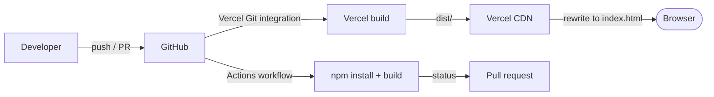

# Deployment

Atria is deployed as a static Vite single-page application. There is no backend, database, or
server-side runtime.

This section documents:

- how to build and verify the app locally;
- how Vercel is configured;
- how SPA rewrites work;
- what GitHub Actions does and does not do;
- common build and hosting problems.

---

## Documents

| Document | Purpose |
|---|---|
| [Build and deployment](build-and-deployment.md) | Local build, Vercel configuration, live routes, rollback |
| [CI/CD](ci-cd.md) | GitHub Actions workflow, no deploy step, no tests |
| [Troubleshooting](troubleshooting.md) | Build, preview, routing, and hosting issues |

---

## Deployment summary

| Concern | Implementation |
|---|---|
| Hosting | Vercel |
| Framework preset | Vite |
| Build command | `npm run build` |
| Output directory | `dist` |
| Install command | `npm install` |
| SPA fallback | Rewrite `/(.*)` to `/index.html` |
| CI | GitHub Actions, Node.js 20, install + build |
| Deploy step in CI | None |
| Environment variables | None |
| Live site | `https://atriastudio.vercel.app` |

---

## Key facts

- `vercel.json` is committed and must remain aligned with the Vite output.
- The CI workflow does **not** deploy; Vercel performs the production build.
- Direct route loads depend on the rewrite rule.
- There is no server-side rendering or server runtime.
- There are no environment-specific branches in the application.

---

## Related documents

- [System architecture](../architecture/system-architecture.md)
- [ADR-0007: Vercel static hosting](../architecture/adr/0007-vercel-spa-rewrites.md)
- [Installation](../getting-started/installation.md)
- [Testing strategy](../quality/testing-strategy.md)
