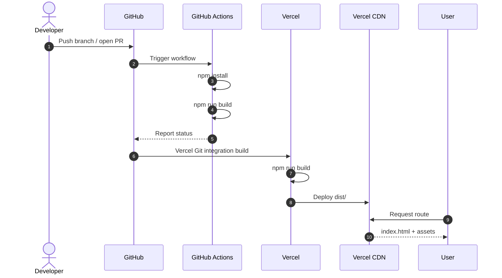

# Build and Deployment

## 1. Overview

Atria builds to static assets with Vite and deploys to Vercel. There is no server-side runtime, API,
database, or environment configuration.

---

## 2. Local production build

```bash
npm install
npm run build
```

Vite writes the production output to `dist/`:

```text
dist/
├── index.html
└── assets/
    ├── index-*.css
    └── index-*.js
```

The exact hashes change per build.

### Preview the build

```bash
npm run preview
```

Vite serves `dist/` locally, typically at `http://localhost:4173/`, with SPA fallback.

### Verified build baseline

During documentation verification:

| Asset | Size | Gzip |
|---|---|---|
| HTML | ~0.91 kB | ~0.49 kB |
| CSS | ~21.84 kB | ~5.09 kB |
| JS | ~358.98 kB | ~107.08 kB |

4,587 modules were transformed. Treat these numbers as a baseline, not a guarantee.

---

## 3. Vercel configuration

`vercel.json`:

```json
{
  "framework": "vite",
  "buildCommand": "npm run build",
  "outputDirectory": "dist",
  "installCommand": "npm install",
  "rewrites": [
    {
      "source": "/(.*)",
      "destination": "/index.html"
    }
  ]
}
```

| Field | Meaning |
|---|---|
| `framework` | Uses Vercel's Vite preset |
| `buildCommand` | Runs the Vite production build |
| `outputDirectory` | Serves the generated `dist/` |
| `installCommand` | Installs dependencies |
| `rewrites` | Serves `index.html` for all paths so client routes work |

### Why rewrites are required

Atria routes such as `/explore/tokens` and `/docs` are handled in the browser. On a direct request, the
host must return `index.html`, not a 404. The rewrite rule provides that fallback.

---

## 4. Live deployment

The public deployment is:

- **Site:** https://atriastudio.vercel.app
- **Docs:** https://atriastudio.vercel.app/docs
- **Studio:** https://atriastudio.vercel.app/explore/foundations

During verification, the root, `/explore`, and `/docs` returned HTTP 200 with the SPA shell.

Deployment timing and preview URLs are managed by Vercel and are not documented here as fixed values.

---

## 5. Deployment workflow



### What GitHub Actions does

- Runs on pushes and pull requests to `main`.
- Uses Node.js 20.
- Runs `npm install`.
- Runs `npm run lint --if-present` (no-op because no lint script exists).
- Runs `npm run build`.

### What GitHub Actions does not do

- It does not deploy.
- It does not run tests.
- It does not run a linter.
- It does not publish artifacts.

---

## 6. Environment variables

No environment variables are required or configured.

If that changes:

1. Add them in Vercel's project settings.
2. Use `VITE_` only for public values.
3. Never expose secrets to the client.
4. Document them in
   [Environment configuration](../getting-started/environment-configuration.md).
5. Update this document.

---

## 7. Rollback and recovery

Vercel retains deployment history. To roll back:

1. Open the Vercel project dashboard.
2. Select the last known-good deployment.
3. Promote or redeploy it.

Repository-level recovery:

1. Revert the offending commit on `main`.
2. Push the revert.
3. Let Vercel build and deploy the previous state.

Because the app is static, rollback does not require data migrations or server rollback.

---

## 8. Release checklist

Before merging a change intended for production:

- [ ] `npm run build` succeeds.
- [ ] CI is green.
- [ ] Manual route checks pass.
- [ ] Direct deep-link loads work in preview.
- [ ] The change is documented.
- [ ] No secrets or private links are included.
- [ ] Screenshots are updated if the public UI changed.
- [ ] The Vercel configuration is unchanged or intentionally updated.

After deployment:

- [ ] `/` loads.
- [ ] `/docs` loads.
- [ ] `/explore/foundations` loads.
- [ ] A deep refresh on `/explore/tokens` works.
- [ ] No console errors.

---

## 9. Related documents

- [CI/CD](ci-cd.md)
- [Troubleshooting](troubleshooting.md)
- [ADR-0007: Vercel static hosting](../architecture/adr/0007-vercel-spa-rewrites.md)
- [Routing](../engineering/routing.md)
- [Performance](../engineering/performance.md)
