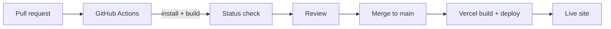

# CI/CD

## 1. Overview

Atria uses GitHub Actions to verify that the project installs and builds. Deployment is handled
separately by Vercel.

This distinction matters: a green CI run means the build succeeds, not that the site was deployed.

---

## 2. Workflow

File: `.github/workflows/ci.yml`

```yaml
name: Frontend CI Pipeline

on:
  push:
    branches: [ main ]
  pull_request:
    branches: [ main ]

jobs:
  build-and-lint:
    runs-on: ubuntu-latest
    steps:
      - name: Checkout repository
        uses: actions/checkout@v4

      - name: Set up Node.js
        uses: actions/setup-node@v4
        with:
          node-version: '20'
          cache: 'npm'

      - name: Install dependencies
        run: npm install

      - name: Run Linter
        run: npm run lint --if-present

      - name: Build Vite App
        run: npm run build
```

---

## 3. Triggers

| Event | Branches |
|---|---|
| Push | `main` |
| Pull request | Target `main` |

Feature branches do not trigger the workflow on push unless they are `main`. The pull request event
covers contributions targeted at `main`.

---

## 4. Steps

| Step | Command | Meaning |
|---|---|---|
| Checkout | `actions/checkout@v4` | Fetch the repository |
| Node setup | `actions/setup-node@v4` | Node.js 20 with npm cache |
| Install | `npm install` | Install dependencies |
| Lint | `npm run lint --if-present` | No-op; no lint script exists |
| Build | `npm run build` | Verify the Vite production build |

### The lint step

`--if-present` makes npm exit successfully when the script is missing. Because `package.json` has no
`lint` script, this step succeeds without linting anything. The step name is therefore misleading.

To enable real linting:

1. Choose a linter and configuration.
2. Add a `lint` script to `package.json`.
3. Run it locally and fix existing issues.
4. Update this document.
5. Optionally remove `--if-present` once the script is guaranteed.

---

## 5. What CI does not do

- Deploy to Vercel.
- Run unit, integration, or end-to-end tests.
- Run accessibility checks.
- Run type checking.
- Publish build artifacts.
- Check documentation links.
- Enforce formatting.

---

## 6. Deployment relationship



- GitHub Actions verifies.
- Vercel builds and deploys via its Git integration.
- The repository's workflow does not call Vercel.

---

## 7. Reproduce CI locally

Use the same major Node.js version as CI:

```bash
node --version
npm install
npm run lint --if-present
npm run build
```

For a lockfile-exact install:

```bash
npm ci
```

The build must succeed before opening a pull request.

---

## 8. Improving CI

Recommended future steps:

1. Add a lint script and real lint step.
2. Add a test framework and test step.
3. Add a format check.
4. Add an accessibility check.
5. Add a documentation link checker.
6. Add a bundle-size check.
7. Pin actions to trusted versions or SHAs.
8. Add dependency review for pull requests.

Each addition should include documentation and a working local command.

---

## 9. Troubleshooting CI

| Symptom | Likely cause | Fix |
|---|---|---|
| Install fails | Lockfile or registry issue | Run `npm install` locally and commit the lockfile |
| Build fails in CI but not locally | Node version mismatch | Use Node.js 20 locally or update CI intentionally |
| Lint step appears to pass | No lint script exists | Add one if linting is required |
| Deploy did not happen | CI is not a deploy pipeline | Check Vercel's deployment status |
| Cache issues | npm cache mismatch | Clear cache or update lockfile |

---

## 10. Related documents

- [Build and deployment](build-and-deployment.md)
- [Troubleshooting](troubleshooting.md)
- [Testing strategy](../quality/testing-strategy.md)
- [Contribution workflow](../contributing/contribution-workflow.md)
