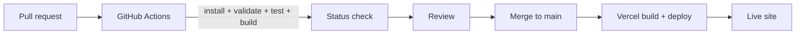

# CI/CD

## 1. Overview

Atria uses GitHub Actions to install locked dependencies, validate community contributions, run the
test suite, and build the production application. Deployment is handled separately by Vercel.

This distinction matters: a green CI run means these checks pass, not that the site was deployed.

---

## 2. Workflow

File: `.github/workflows/ci.yml`

```yaml
name: CI

on:
  push:
    branches: [ main ]
  pull_request:
    branches: [ main ]

jobs:
  build:
    runs-on: ubuntu-latest
    steps:
      - name: Checkout repository
        uses: actions/checkout@v7

      - name: Set up Node.js
        uses: actions/setup-node@v7
        with:
          node-version: '20'
          cache: 'npm'

      - name: Install dependencies
        run: npm ci

      - name: Validate community contributions
        run: npm run validate:contributions

      - name: Run tests
        run: npm test

      - name: Build Vite app
        run: npm run build
```

---

## 3. Triggers

| Event | Branches |
|---|---|
| Push | `main` |
| Pull request | Target `main` |

Feature branches do not trigger the workflow on push unless they are `main`. The pull request event
covers contributions targeted at `main`.

---

## 4. Steps

| Step | Command | Meaning |
|---|---|---|
| Checkout | `actions/checkout@v7` | Fetch the repository |
| Node setup | `actions/setup-node@v7` | Node.js 20 with npm cache |
| Install | `npm ci` | Install lockfile-defined dependencies |
| Contribution validation | `npm run validate:contributions` | Reject invalid JSON contribution files |
| Tests | `npm test` | Run Vitest and Testing Library tests |
| Build | `npm run build` | Verify the Vite production build |

### Linting

No lint step runs because `package.json` does not define a `lint` script. A successful CI run is not
evidence that lint checks have run. If linting is added later, update both the workflow and this
document to show the actual command.

---

## 5. What CI does not do

- Deploy to Vercel.
- Run end-to-end tests.
- Run accessibility checks.
- Run linting (no lint script is configured).
- Run type checking.
- Publish build artifacts.
- Check documentation links.
- Enforce formatting.

---

## 6. Deployment relationship



- GitHub Actions verifies.
- Vercel builds and deploys via its Git integration.
- The repository's workflow does not call Vercel.

---

## 7. Reproduce CI locally

Use the same major Node.js version as CI:

```bash
node --version
npm ci
npm run validate:contributions
npm test
npm run build
```

For a lockfile-exact install:

```bash
npm ci
```

The build must succeed before opening a pull request.

---

## 8. Improving CI

Recommended future steps:

1. Add a lint script and real lint step.
2. Add a format check.
3. Add an accessibility check.
4. Add a documentation link checker.
5. Add a bundle-size check.
6. Pin actions to trusted versions or SHAs.
7. Add dependency review for pull requests.

Each addition should include documentation and a working local command.

---

## 9. Troubleshooting CI

| Symptom | Likely cause | Fix |
|---|---|---|
| Install fails | Lockfile or registry issue | Run `npm install` locally and commit the lockfile |
| Build fails in CI but not locally | Node version mismatch | Use Node.js 20 locally or update CI intentionally |
| Deploy did not happen | CI is not a deploy pipeline | Check Vercel's deployment status |
| Cache issues | npm cache mismatch | Clear cache or update lockfile |

---

## 10. Related documents

- [Build and deployment](build-and-deployment.md)
- [Troubleshooting](troubleshooting.md)
- [Testing strategy](../quality/testing-strategy.md)
- [Contribution workflow](../contributing/contribution-workflow.md)
