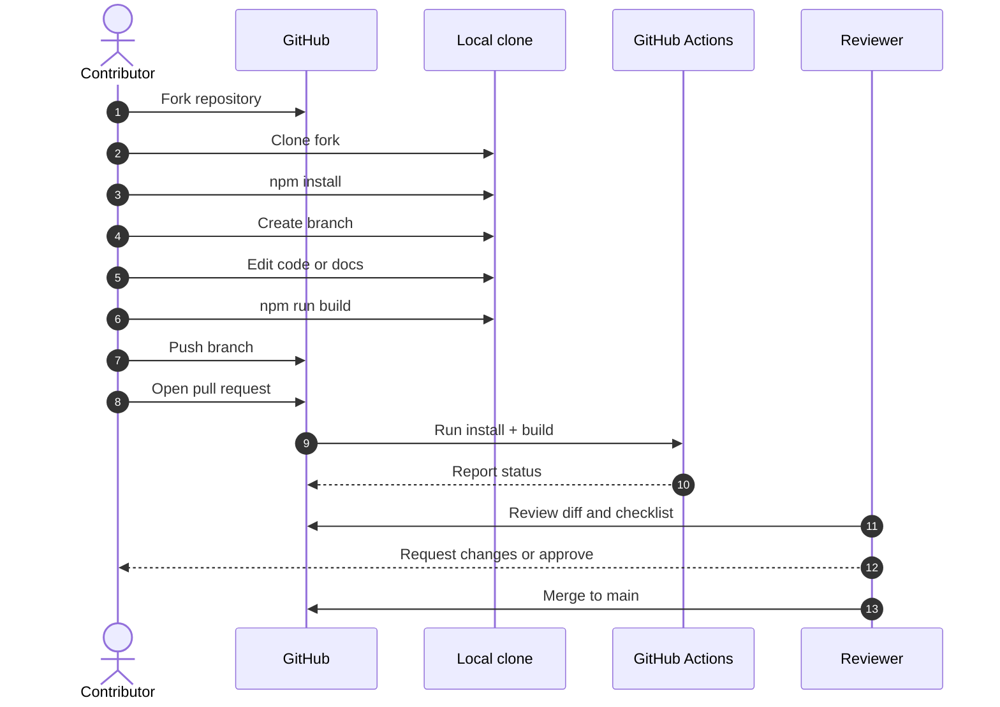

# Application Workflows

## 1. Purpose

This document describes the main workflows a person can complete in Atria today, plus the intended
contributor workflow for working on the repository. It is grounded in the current implementation; no
workflow depends on an API, database, authentication, or persistence.

---

## 2. Workflow map

```mermaid
flowchart TD
  Start([Open Atria]) --> Landing{Landing page}
  Landing --> Hero[Read product positioning]
  Hero --> ExploreSections[Browse idea, foundations, components, contact]
  ExploreSections --> Playground[Switch playground tabs]
  ExploreSections --> Copy[Copy demo token]
  ExploreSections --> StudioCTA[Explore the studio]
  ExploreSections --> DocsCTA[Docs]
  ExploreSections --> GitHubCTA[GitHub]

  StudioCTA --> Studio[/explore/foundations]
  Studio --> F[Read Foundations brief]
  Studio --> T[Read Tokens brief]
  Studio --> C[Read Components brief]

  DocsCTA --> Docs[/docs]
  Docs --> Collections[Browse Product / Design / Engineering]
  Collections --> ExternalDoc[Open Google Doc]

  GitHubCTA --> Repo[GitHub repository]
  Repo --> Fork[Fork]
  Fork --> Setup[Clone + npm install]
  Setup --> Develop[Edit + npm run dev]
  Develop --> Build[npm run build]
  Build --> PR[Open pull request]
```

---

## 3. Visitor workflow

### Goal

Understand what Atria is and whether it is relevant.

### Steps

1. Open `/`.
2. Read the hero: product positioning and primary CTA.
3. Scroll through the idea, foundations, and component sections.
4. Optionally use the playground tabs.
5. Optionally copy the demo token.
6. Follow contact links or the GitHub CTA.

### System behaviour

- All content is static and immediate.
- Playground state is local.
- Clipboard access is user-initiated.
- External links open new tabs.
- No account or sign-up is required.

### Friction points

- The preview panel is illustrative, not interactive data.
- The foundation cards are not links.
- The token copy is a single literal value.
- The page does not explain that Studio sections are placeholders until the visitor enters them.

---

## 4. Documentation reader workflow

### Goal

Find product, design, or engineering context.

### Steps

1. Open `/docs` from the landing nav/footer or a direct link.
2. Read the hub introduction.
3. Choose a collection: Product, Design, or Engineering.
4. Open a document card.
5. Read the external Google Doc.
6. Return to Atria using the browser or the Docs back link.

### System behaviour

- `/docs` is rendered by the entry branch outside React Router.
- Cards open Google Docs in a new tab.
- Returning to `/` is a full page load.
- External document access depends on Google Docs sharing settings.

### Friction points

- No search or filtering.
- No in-app document rendering.
- No indication beyond the card that a document is external.
- Access errors are handled by Google Docs, not Atria.

---

## 5. Studio explorer workflow

### Goal

Understand the intended Foundations, Tokens, and Components capabilities.

### Steps

1. Open `/explore`.
2. Get redirected to `/explore/foundations`.
3. Read the Foundations brief.
4. Use the sidebar to open Tokens and Components.
5. Read the task lists and developer notes.

### System behaviour

- The layout persists across section navigation.
- Sidebar active state follows the URL.
- Each brief is static.
- No editing, saving, or preview execution exists.

### Friction points

- The sections look like a working studio but are documentation.
- There is no "coming soon" modal or onboarding explanation beyond the status label.
- Deep links are shareable, but the content is not user-specific.

### Contributor follow-up

After reading a brief, a contributor may:

1. Open or discuss an issue.
2. Choose one task area.
3. Define the data model.
4. Implement the editor and preview.
5. Add validation and tests.
6. Update the brief status.

---

## 6. Contributor workflow



### Steps in detail

1. Fork `breeze-sn/Atria`.
2. Clone your fork.
3. Install dependencies with `npm install`.
4. Create a focused branch.
5. Make the change.
6. Run `npm run build`.
7. Perform manual checks from [Testing strategy](../quality/testing-strategy.md).
8. Update documentation in the same change.
9. Commit with a clear message.
10. Push and open a pull request using the template.
11. Respond to review.
12. Merge after approval.

Read [Contribution workflow](../contributing/contribution-workflow.md) for commands and
[Pull request guidelines](../contributing/pull-request-guidelines.md) for the PR format.

---

## 7. Error and fallback workflows

| Situation | Workflow |
|---|---|
| Unknown route | Redirect to `/` |
| Legacy `/studio/*` route | Redirect to `/explore` |
| Clipboard denied | Button stays at `COPY`; no error message |
| Google Fonts unavailable | Fallback fonts |
| External doc unavailable | Browser shows external error |
| Build failure | CI fails; fix locally and push again |
| JavaScript disabled | No app content is rendered |

---

## 8. Future workflows (not implemented)

The following are described in the briefs but do not exist:

- create and edit foundation values;
- preview light/dark colour themes;
- create primitive and semantic tokens;
- validate token references and cycles;
- export CSS variables and JSON;
- publish and discover components;
- authenticate and manage a workspace;
- share a design system with a team.

Do not document these as user workflows until they are implemented.

---

## 9. Related documents

- [Landing page](../features/landing-page.md)
- [Explore Studio](../features/explore-studio.md)
- [Documentation hub](../features/documentation-hub.md)
- [State management](state-management.md)
- [Error handling](error-handling.md)
- [Contribution workflow](../contributing/contribution-workflow.md)
