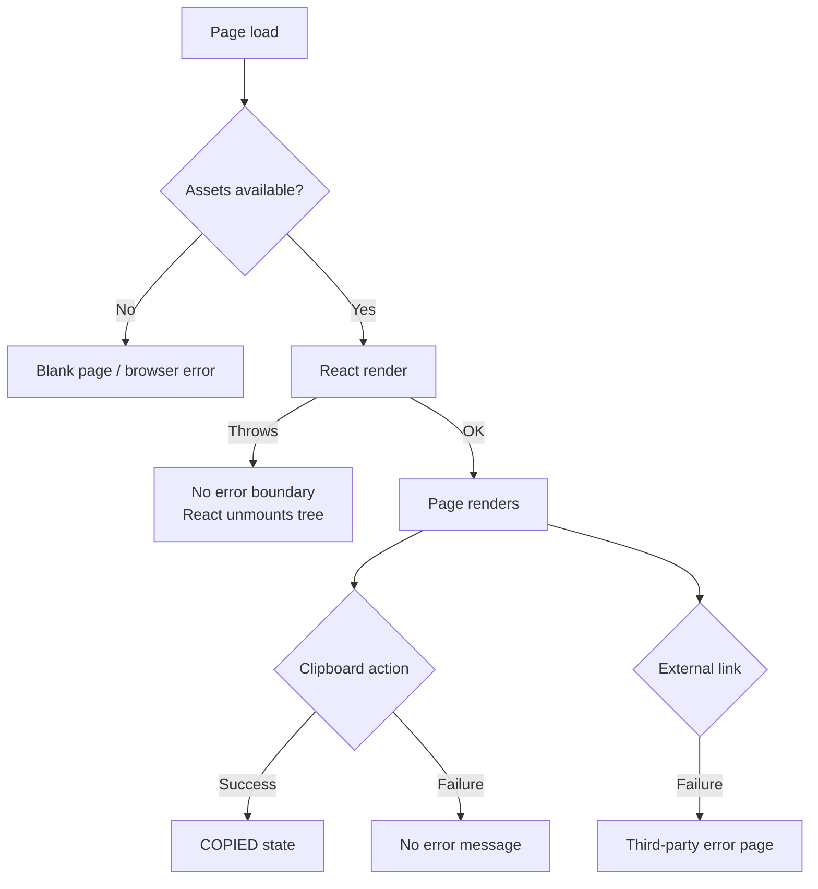

# Error Handling

## 1. Overview

Atria is a static client-side application. Its runtime error surface is small, and most failure modes
are either browser-level or build-time.

There is currently:

- no API error handling;
- no error boundary;
- no global error reporting;
- no retry logic;
- no user-facing error UI beyond the clipboard fallback.

This document records what exists, what does not, and where safeguards should be added as the product
grows.

---

## 2. Existing safeguards

### 2.1 Clipboard failure

```js
try {
  await navigator.clipboard.writeText('--atria-space-4: 16px;')
  setCopied(true)
  window.setTimeout(() => setCopied(false), 1800)
} catch {
  setCopied(false)
}
```

- Prevents a false "COPIED" state when the clipboard write fails.
- Does not display an error message.
- Does not log the error.
- Common causes: denied permission, insecure context, unsupported browser.

### 2.2 Route fallback

- Unknown routes redirect to `/`.
- `/studio/*` redirects to `/explore`.
- `/explore` redirects to `/explore/foundations`.

This prevents blank screens from unmatched routes, although it can hide a broken link destination.

### 2.3 Build-time validation

- Vite fails the build on syntax and module resolution errors.
- CI runs the production build on pushes and pull requests to `main`.
- Vercel builds before deploying.

### 2.4 Reduced-motion safeguard

`prefers-reduced-motion` reduces animation and transition duration. This is not error handling, but it
is a resilience/accessibility safeguard.

---

## 3. Missing safeguards

| Safeguard | Status | Risk |
|---|---|---|
| React error boundary | Missing | A render error can blank the page |
| Global `window.onerror` reporting | Missing | Errors are invisible to maintainers |
| 404 page | Replaced by redirect | Broken links silently go home |
| Loading states | Not needed today | Becomes relevant with data fetching |
| API error UI | Not applicable | No API |
| Empty states | Missing | Studio briefs are static; future editors need them |
| Form validation | Not applicable | No forms |
| Offline handling | Missing | App requires network for first load and fonts |
| Clipboard error message | Missing | Users may not know why copy failed |
| Link checking | Missing | External docs can rot |

---

## 4. Failure mode analysis



### Rendering errors

Without an error boundary, an exception during render propagates to React and can remove the UI. The
current components are simple and static, so the risk is low, but it increases with data-driven
Studio features.

### Asset failures

If the JavaScript bundle fails to load, the page is blank because there is no server-rendered fallback.
The HTML shell contains only `#root` and the module script.

### External failures

Google Docs, GitHub, LinkedIn, the personal website, and Google Fonts are outside Atria's control. The
app cannot recover their failures.

---

## 5. Recommended improvements

These are proposals, not implemented work.

### Short term

1. Add a top-level error boundary with a readable fallback and a link home.
2. Show a small inline message when clipboard copy fails.
3. Add a documented 404 view or preserve redirects with a visible notice.
4. Add a basic link-checking step for repository docs and external URLs where feasible.

### Medium term

1. Add empty, loading, and error states to Studio editors.
2. Add form validation messages for token and foundation inputs.
3. Add an error reporting integration if the product collects telemetry.
4. Add tests for failure paths, not only happy paths.

### Long term

1. Define API error contracts and retry policy if a backend is introduced.
2. Add offline or degraded-mode behaviour where appropriate.
3. Add observability and alerting for production errors.

Any of these should come with documentation and tests.

---

## 6. Error message guidelines

When adding user-facing errors:

- State what happened in plain language.
- Say what the user can do next.
- Avoid exposing stack traces or internal identifiers.
- Do not blame the user.
- Keep the current content visible where possible.
- Use accessible live regions for asynchronous errors.

Example:

> We couldn't copy the token. Check your browser's clipboard permission and try again.

---

## 7. Related documents

- [State management](state-management.md)
- [Application workflows](application-workflows.md)
- [Testing strategy](../quality/testing-strategy.md)
- [Accessibility](../quality/accessibility.md)
- [Security and authentication](security-and-authentication.md)
