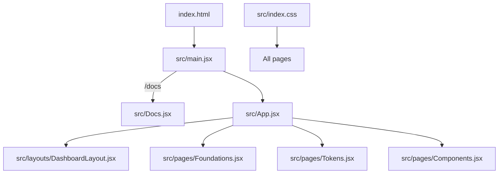
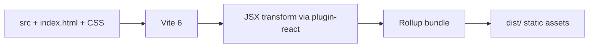

# Frontend Architecture

## 1. Overview

Atria's frontend is a Vite-built React single-page application written in JavaScript and JSX. It has
two entry branches, one router, nine React components (including page functions), and one global
stylesheet.

For deeper architecture, read:

- [System architecture](../architecture/system-architecture.md)
- [Component architecture](../architecture/component-architecture.md)
- [Low-level design](../architecture/low-level-design.md)

---

## 2. Directory responsibilities

### `src/main.jsx`

- Mounts React into `#root`.
- Chooses `Docs` or `App` based on `window.location.pathname`.
- Imports the global stylesheet.
- Wraps the tree in `React.StrictMode`.

This file should stay small. It is an entry point, not a place for business logic.

### `src/App.jsx`

- Defines the `LandingPage` component.
- Defines the route tree with `BrowserRouter`, `Routes`, `Route`, and `Navigate`.
- Holds landing-page static data and local interaction state.
- Imports layout and Studio page components.

This file is the largest application module because it combines the marketing page with routing. If it
grows further, extracting `LandingPage` into `src/pages/LandingPage.jsx` would be reasonable.

### `src/Docs.jsx`

- Renders the documentation hub.
- Holds the `groups` data array.
- Uses native anchors because it is outside the router.

### `src/layouts/DashboardLayout.jsx`

- Provides the Explore Studio frame.
- Holds the `sections` navigation array.
- Defines `AtriaMark` and `ExploreFooter`.
- Renders the matched child route through `<Outlet />`.

### `src/pages/*.jsx`

- One component per Studio section.
- Static implementation briefs.
- No data fetching, editing, or persistence.

### `src/index.css`

- Global reset and root variables.
- Shared layout and component classes.
- Landing, Docs, Studio, and Explore styles.
- Responsive and reduced-motion rules.

---

## 3. Import conventions

Observed conventions in the repository:

- ES module imports.
- Relative paths with explicit extensions for local JavaScript/JSX files where used
  (`./App.jsx`, `./pages/Tokens.jsx`).
- CSS imported once in `src/main.jsx` (`./index.css`).
- Third-party packages imported by package name.
- Icons imported as named exports from `@phosphor-icons/react`.

There are no path aliases, barrel files, or re-export modules.

---

## 4. Component conventions

- Function components only.
- `LandingPage`, `Docs`, and page components are default exports.
- `DashboardLayout` is a default export.
- `AtriaMark` and `ExploreFooter` are internal functions used by the layout.
- Static data arrays are module-level constants.
- JSX uses `className`, self-closing tags, and inline expressions for conditional rendering.
- State uses `useState` from React.
- Styling uses global class names rather than styled components or CSS modules.

---

## 5. Styling organisation

The stylesheet is grouped by product area:

| Group | Representative selectors |
|---|---|
| Base and shell | `:root`, `*`, `body`, `.shell` |
| Navigation and brand | `.nav`, `.brand`, `.brand-mark`, `.nav-cta` |
| Landing hero | `.hero`, `.hero-art`, `.art-*` |
| Ticker | `.ticker`, `.ticker-track` |
| Intro and foundations | `.intro-section`, `.foundations-section`, `.foundation-*` |
| Component playground | `.components-section`, `.preview-*`, `.sample-*` |
| Token strip | `.token-strip`, `.token-*`, `.code-snippet` |
| Footer | `.footer`, `.footer-*` |
| Contact | `.contact-*` |
| Documentation | `.docs-*`, `.doc-*` |
| Legacy Studio | `.studio-shell`, `.studio-sidebar`, `.studio-nav` |
| Studio briefs | `.studio-page`, `.studio-brief`, `.studio-task`, `.studio-dev-note` |
| Explore layout | `.explore-*` |

See [Styling and design tokens](styling-and-design-tokens.md) for the token values and breakpoints.

---

## 6. State and data

- `activeTab` and `copied` in `LandingPage` are the only state variables.
- All other content is static.
- The URL is the navigation state.
- No context, store, reducer, query cache, or data fetching.
- No persistence.

See [State management](state-management.md) and [Data flow](../architecture/data-flow.md).

---

## 7. Build pipeline

- `vite.config.js` registers only `@vitejs/plugin-react`.
- No environment variables or aliases.
- Production output is static.
- CI verifies the build with Node.js 20.

---

## 8. Performance characteristics

- No route-level code splitting.
- All page code ships in one JavaScript bundle.
- Phosphor Icons are tree-shaken by the bundler, but icon imports still contribute.
- Google Fonts load from a third-party origin.
- CSS is a single file.
- No images are used in the application; the visual preview is CSS/markup and icons.

Measured production build during verification:

| Asset | Size | Gzip |
|---|---|---|
| JavaScript | ~358.98 kB | ~107.08 kB |
| CSS | ~21.84 kB | ~5.09 kB |
| HTML | ~0.91 kB | ~0.49 kB |

Exact hashes and sizes change with code changes. See [Performance](performance.md).

---

## 9. Accessibility and responsiveness

Present:

- semantic landmarks;
- labelled navigation;
- native controls;
- reduced-motion media query;
- responsive breakpoints.

Absent:

- automated accessibility tests;
- formal contrast audit;
- error boundary;
- skip link.

See [Accessibility](../quality/accessibility.md).

---

## 10. Where to add things

| Need | Location |
|---|---|
| New public section | `LandingPage` in `src/App.jsx` + landing CSS |
| New route | `src/App.jsx` route table |
| New Studio section | `src/pages/` + route + `sections` array + CSS |
| New documentation page | `docs/` + index links |
| New shared visual pattern | `src/index.css` with a clear class prefix |
| New shared component | `src/` with a focused responsibility and usage in at least two places |

Do not introduce a new library or architectural layer without an ADR and a demonstrated need.

---

## 11. Related documents

- [System architecture](../architecture/system-architecture.md)
- [Component architecture](../architecture/component-architecture.md)
- [Routing](routing.md)
- [Styling and design tokens](styling-and-design-tokens.md)
- [State management](state-management.md)
- [Performance](performance.md)
- [Coding standards](../quality/coding-standards.md)
