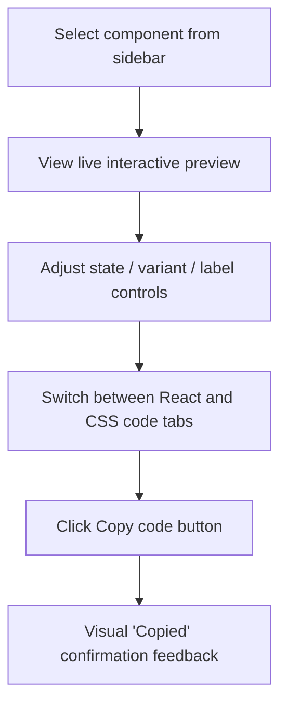

# Component Library

**Status:** Implemented, limited
**Route:** `/explore/components`
**Source:** `src/pages/Components.jsx`

The Components page is a curated catalogue of ten reusable interface examples. Each entry includes an interactive live preview with light and dark mode toggling, state and variant switchers, and copy-ready React and CSS snippets.

---

## 1. Current component catalogue

The library contains ten foundational components across four categories:

| Component | Category | Demonstrated variants / states | Purpose in Atria |
|---|---|---|---|
| [Button](#21-button) | Actions | Primary, Secondary, Ghost, Disabled | Trigger actions in forms, dialogs, and page flows |
| [Text field](#22-text-field) | Forms | Default, Error, Disabled | Labelled single-line input with hint and error feedback |
| [Status badge](#23-status-badge) | Feedback | Neutral, Success, Warning | Non-interactive indicator for status, lifecycle, or category |
| [Content card](#24-content-card) | Layout | Default, Interactive | Group related content, summaries, and actions |
| [Avatar](#25-avatar) | Identity | Small, Medium, Large | Compact visual representation of user initials with accessible label |
| [Navigation bar](#26-navigation-bar) | Navigation | Default, Compact | Horizontal navigation bar with an active page marker |
| [Modal dialog](#27-modal-dialog) | Overlays | Open, Closed | Focused overlay for short tasks, alerts, or confirmations |
| [Dropdown select](#28-dropdown-select) | Forms | Default, Disabled | Native single-choice selection from a list of options |
| [Tabs](#29-tabs) | Navigation | Overview, Activity, Settings | Switch between alternating views without navigating away |
| [Checkbox](#210-checkbox) | Forms | Unchecked, Checked, Disabled | Labelled binary toggle for independent options and settings |

---

## 2. Component reference and usage guidance

### 2.1 Button

A reusable action element for forms, dialogs, and page flows.

- **Category:** Actions
- **Code:** `export function Button({ children, variant = "primary", disabled = false, ...props })`
- **CSS classes:** `.button`, `.button--primary`, `.button--secondary`, `.button--ghost`, `.button:disabled`

#### Demonstrated variants and states

- **Primary:** High-emphasis call to action using a solid dark background (`#242420`) and white text.
- **Secondary:** Medium-emphasis alternative action using a white background with a dark border and text.
- **Ghost:** Low-emphasis action using a transparent background and transparent border.
- **Disabled:** Visually dimmed (`opacity: 0.45`, `cursor: not-allowed`) with the native HTML `disabled` attribute applied.
- **Interactive preview:** Supports live button label editing and state switching.

#### Usage guidance

- **When to use:**
  - Submitting or resetting form inputs.
  - Triggering immediate in-page actions such as opening modals or clearing data.
  - Confirming or cancelling an operation in a dialog.
- **When not to use:**
  - Navigating between different URLs or pages (use standard links `<a>` or router links `<Link>` instead).
  - Displaying non-interactive status or category labels (use [Status badge](#23-status-badge)).

#### Accessibility notes

- **Keyboard:** Uses the native `<button>` element, providing built-in keyboard activation via `Enter` and `Space`.
- **Accessible name:** Ensure every button has descriptive text or an `aria-label` attribute if using an icon-only label.
- **Disabled state:** Native `disabled` removes the button from the tab sequence and ignores mouse/touch events. If users need to understand why an action is disabled, consider using `aria-disabled="true"` with an explanatory tooltip or helper text instead of completely suppressing focus.
- **Focus indicator:** Maintain clear `:focus-visible` styling when integrating into custom themes.

---

### 2.2 Text field

A labelled text input with focus styling and validation feedback.

- **Category:** Forms
- **Code:** `export function TextField({ label, hint, error, ...props })`
- **CSS classes:** `.field`, `.field__label`, `.field__input`, `.field__input--error`

#### Demonstrated variants and states

- **Default:** Clean single-line text input with a neutral border (`#d8d6cf`) and bold label.
- **Focus:** Highlighted with a visible outline (`outline: 2px solid #aaa79f; outline-offset: 2px`).
- **Error:** Red border (`#b54747`), sets `aria-invalid="true"`, and displays an error message beneath the input.
- **Disabled:** Inactive state using the native `disabled` attribute to prevent user input.
- **Interactive preview:** Demonstrates live text input handling with email format feedback.

#### Usage guidance

- **When to use:**
  - Collecting short single-line alphanumeric text, such as names, email addresses, or search terms.
  - Forms requiring explicit field validation messages.
- **When not to use:**
  - Long multi-line text (use a `<textarea>` instead).
  - Selecting from a predefined list of options (use [Dropdown select](#28-dropdown-select) or radio buttons).
  - Toggling binary preferences (use [Checkbox](#210-checkbox)).

#### Accessibility notes

- **Labels:** The `<input>` is wrapped inside a `<label className="field">`, providing an implicit accessible name and expanding the click target to the label text.
- **Validation:** When `error` is provided, `aria-invalid="true"` is set on the input to alert assistive technologies.
- **Error description caveat:** In the current example snippet, the `<small>` error/hint element is rendered adjacent to the input but lacks an `id` linked via `aria-describedby`. In production code, add an `id` to the error/hint message and pass `aria-describedby="{id}"` to the `<input>` so screen readers announce the message upon focus.
- **Keyboard:** Standard tab navigation and text editing key shortcuts.

---

### 2.3 Status badge

A compact, non-interactive visual indicator for object status, state, or category.

- **Category:** Feedback
- **Code:** `export function Badge({ children, tone = "neutral" })`
- **CSS classes:** `.badge`, `.badge__dot`, `.badge--success`, `.badge--warning`

#### Demonstrated variants and states

- **Neutral:** Muted grey styling (`#f4f3ef` background, `#55534f` text) with a circular dot indicator (e.g. "Draft").
- **Success:** Soft green styling (`#edf4ea` background, `#45633b` text) with a circular dot indicator (e.g. "Published").
- **Warning:** Soft amber styling (`#fbf3e3` background, `#876321` text) with a circular dot indicator (e.g. "Needs review").

#### Usage guidance

- **When to use:**
  - Indicating publication, lifecycle, or review status of a resource or document.
  - Displaying non-clickable classification tags or metadata in list views and headers.
- **When not to use:**
  - Filter chips or interactive tags that trigger actions when clicked (use `<button>` with badge styling instead).
  - Long descriptive notifications or multi-sentence alerts (use banner or alert components).

#### Accessibility notes

- **Non-interactive semantics:** Rendered as an inline ``. It does not accept keyboard focus or click events.
- **Color independence:** Status must never be conveyed by color alone (WCAG 1.4.1). In Atria's examples, the visible text label ("Published", "Needs review", "Draft") conveys the status, while the `.badge__dot` uses `currentColor` as decorative emphasis.
- **Screen readers:** Assistive technology reads the inner text directly. If badge status changes dynamically in response to background jobs, ensure the containing section or parent status area uses an `aria-live` region.

---

### 2.4 Content card

A flexible container for grouped information, summaries, and related actions.

- **Category:** Layout
- **Code:** `export function Card({ title, description, children, ...props })`
- **CSS classes:** `.card`, `.card__title`, `.card__description`

#### Demonstrated variants and states

- **Default:** Clean bordered container (`1px solid #deddd8`, `border-radius: 10px`, white background).
- **Interactive:** Elevated visual style with a subtle drop shadow (`box-shadow: 0 8px 24px #00000012`) and embedded action link.

#### Usage guidance

- **When to use:**
  - Grouping related content into a distinct visual module (e.g. resource overviews, project teasers, dashboard items).
  - Pairing a concise heading and summary paragraph with child controls or links.
- **When not to use:**
  - Large tabular data grids (use structured HTML tables).
  - Wrapping entire page layouts where a generic structural `<section>` or `<main>` is appropriate.
  - Making an entire card clickable while nesting other interactive buttons or links inside it.

#### Accessibility notes

- **Semantics:** Uses the semantic `<article>` element to represent an independent, self-contained piece of content.
- **Heading structure:** The snippet uses an `<h3>` for `.card__title`. Ensure heading levels are adjusted in production to match the host page's heading hierarchy (`<h2>`, `<h3>`, etc.).
- **Interactive nesting:** When cards contain links or buttons, keyboard users navigate through each child control sequentially using `Tab`. Avoid wrapping the outer `<article>` in an anchor `<a>` if it contains other links or buttons.

---

### 2.5 Avatar

An initials avatar with an accessible label for user or entity representation.

- **Category:** Identity
- **Code:** `export function Avatar({ name, size = "md" })`
- **CSS classes:** `.avatar`, `.avatar--sm`, `.avatar--md`, `.avatar--lg`

#### Demonstrated variants and states

- **Small (`sm`):** 28 × 28 px (font size 10px), suitable for compact list items, dense tables, or nested comments.
- **Medium (`md`):** 40 × 40 px (font size 12px), the default size for navigation bars and card headers.
- **Large (`lg`):** 56 × 56 px (font size 16px), suitable for profile headers or user detail cards.
- **Initials extraction:** Automatically extracts up to two uppercase initial letters from the provided `name` prop (e.g., "Sample user" yields "SN").

#### Usage guidance

- **When to use:**
  - Representing users, authors, or assignees when photographs are unavailable or loading.
  - Providing a compact identity anchor in navigation headers, profile summaries, or activity feeds.
- **When not to use:**
  - Detailed logos, artwork, or decorative illustrations.
  - Standalone interactive buttons (wrap the avatar in a `<button>` if it opens an account menu).

#### Accessibility notes

- **Accessible naming:** Uses `role="img"` and `aria-label={name}` on the container ``. This ensures assistive technologies announce the full name (e.g., "Sample user") rather than reading separate letters ("S N").
- **Non-interactive by default:** The avatar itself is not a tab stop. If used as an account menu trigger, wrap it inside a `<button>` element with `aria-haspopup="true"` and an appropriate label.

---

### 2.6 Navigation bar

A responsive horizontal navigation pattern with an active page indicator.

- **Category:** Navigation
- **Code:** `export function Navigation({ items, active })`
- **CSS classes:** `.navigation`, `.navigation a`, `.navigation a[aria-current="page"]`

#### Demonstrated variants and states

- **Default:** Standard link padding (`9px 12px`) with comfortable touch targets.
- **Compact:** Tighter link padding (`6px 8px`) for space-constrained navigation bars.
- **Active state:** Inverted dark background (`#242420`) and white text with `aria-current="page"`.

#### Usage guidance

- **When to use:**
  - Top-level site navigation and header navigation across primary routes.
  - Section-level sub-navigation where each link navigates to a distinct URL.
- **When not to use:**
  - Alternating views within the same page without URL navigation (use [Tabs](#29-tabs)).
  - Groups of immediate action buttons (use a toolbar with buttons).

#### Accessibility notes

- **Landmarks:** Uses the semantic `<nav>` element with `aria-label="Main navigation"` to establish a navigable landmark for screen reader users.
- **Current page marker:** Applies `aria-current="page"` to the link matching the current route, enabling assistive technologies to announce which page is active.
- **Keyboard interaction:** Native anchor links participate in normal tab order (`Tab` and `Shift+Tab`) and activate via `Enter`.

---

### 2.7 Modal dialog

An overlay dialog for focused confirmations, critical alerts, and short tasks.

- **Category:** Overlays
- **Code:** `export function Dialog()` (includes internal state trigger and dismiss controls)
- **CSS classes:** `.dialog-backdrop`, `.dialog`, `.dialog h2`, `.dialog p`

#### Demonstrated variants and states

- **Closed:** Dialog overlay unmounted; only the opening trigger button is visible.
- **Open:** Semi-transparent dark backdrop (`#17171780`) covers the viewport, centering a modal card with a title, body text, close `[X]` button, and confirmation button.
- **Interactive preview:** Demonstrates full open and close interaction via trigger button, close button, done button, and backdrop click.

#### Usage guidance

- **When to use:**
  - High-impact decisions requiring explicit confirmation (e.g. deleting a resource or discarding unsaved edits).
  - Self-contained sub-tasks requiring immediate user focus before returning to the main workflow.
- **When not to use:**
  - Passive notifications or non-critical feedback (use toasts, badges, or inline alerts).
  - Complex, lengthy multi-step forms that benefit from full-page context.
  - Routine content browsing (dialogs disrupt flow and hide background context).

#### Accessibility notes and implementation caveats

- **ARIA attributes present:**
  - The modal panel uses `role="dialog"`.
  - Marked with `aria-modal="true"` to signal that background content is inert.
  - Headings are labelled using `aria-labelledby="dialog-title"` pointing to `<h2 id="dialog-title">`.
  - The backdrop container uses `role="presentation"`.
- **Shipped example caveats (production gaps):**
  - **Focus trapping:** The shipped example does *not* trap keyboard focus within the open dialog; pressing `Tab` can cycle into the background document.
  - **Focus restoration:** When closed, the example does *not* return focus to the button that opened the dialog.
  - **Escape key:** The example does *not* bind an `Escape` key listener to dismiss the overlay.
  - **Scroll lock:** The example does *not* disable background scrolling on `document.body` while open.
- **Production recommendation:** Treat this snippet as an illustrative layout starting point. In production applications, use the native HTML `<dialog>` element with `.showModal()` or an audited accessibility library (such as Radix UI Dialog or React Aria) to ensure full WCAG dialog compliance.

---

### 2.8 Dropdown select

A styled native select control with an associated label and predefined options.

- **Category:** Forms
- **Code:** `export function SelectField({ label, options, ...props })`
- **CSS classes:** `.select-field`, `.select-field select`

#### Demonstrated variants and states

- **Default:** Clean single-choice selector displaying the currently chosen option.
- **Focus:** Highlighted with a visible focus ring (`outline: 2px solid #aaa79f; outline-offset: 2px`).
- **Disabled:** Applied via the native `disabled` attribute, preventing user interaction.
- **Interactive preview:** Demonstrates workspace category selection (`Design`, `Engineering`, `Research`, `Marketing`).

#### Usage guidance

- **When to use:**
  - Selecting a single option from a list of 5 to 15 mutually exclusive items where form space is limited.
  - Settings menus with standard choices.
- **When not to use:**
  - Selecting between 2 to 4 options (use radio buttons or segmented controls so all options remain visible without opening a menu).
  - Selecting multiple options simultaneously (use [Checkbox](#210-checkbox) groups or a multi-select listbox).
  - Very large lists (>15 items, where a searchable combobox or autocomplete input is preferred).

#### Accessibility notes

- **Native control benefits:** By leveraging the native `<select>` element, the component inherits complete operating system accessibility:
  - Screen readers announce the label, role, current value, and item index.
  - Mobile operating systems display their native picker sheets with full zoom and touch accommodation.
- **Labeling:** Wrapped inside `<label className="select-field">{label}...`, creating a valid label association.
- **Keyboard navigation:** Supports full standard keyboard controls:
  - `Tab` moves focus to the select box.
  - `Up` and `Down` arrow keys cycle through options.
  - Typing characters activates type-ahead option matching.
  - `Space` or `Alt+Down` opens the dropdown menu on supporting browsers.

---

### 2.9 Tabs

A tablist component for alternating between related content views without leaving the page.

- **Category:** Navigation
- **Code:** `export function Tabs({ tabs, active, onChange })`
- **CSS classes:** `.tabs`, `.tabs button`, `.tabs button[aria-selected="true"]`

#### Demonstrated variants and states

- **Selected tab:** Highlighted with an active bottom border (`border-bottom: 2px solid #242420`), darkened text, and `aria-selected="true"`.
- **Inactive tab:** Subdued text color (`#777`) with a transparent bottom border.
- **Interactive preview:** Demonstrates switching between `Overview`, `Activity`, and `Settings` views with live content panel updates.

#### Usage guidance

- **When to use:**
  - Dividing content into parallel, mutually exclusive views on the same page at the same hierarchical level.
  - Switching between related representations of the same subject (e.g. Overview vs Activity vs Settings, or React vs CSS code snippets).
- **When not to use:**
  - Multi-step linear sequences or forms (use a stepper or numbered wizard).
  - Primary site navigation that changes routes or URLs (use [Navigation bar](#26-navigation-bar)).

#### Accessibility notes and implementation caveats

- **ARIA roles present:**
  - The container uses `role="tablist"`.
  - Individual tab triggers use `<button role="tab">` with `aria-selected={active === tab}`.
- **Shipped example caveats (production gaps):**
  - **Keyboard navigation:** The current snippet uses standard button tabs in tab order. The full WAI-ARIA Tabs pattern specifies roving `tabindex` (`tabindex={active === tab ? 0 : -1}`) and arrow key navigation (`ArrowLeft` / `ArrowRight`) to switch tabs without requiring a tab stop per item.
  - **Panel association:** The example renders content panels conditionally, but does not attach `role="tabpanel"`, `id`, and `aria-labelledby` referencing the activating tab.
- **Production recommendation:** When building complex tab interfaces, add arrow key event listeners, roving tabindex management, and linked `aria-controls` / `aria-labelledby` IDs between tabs and tabpanels.

---

### 2.10 Checkbox

A labelled checkbox control for independent binary settings and multi-select forms.

- **Category:** Forms
- **Code:** `export function Checkbox({ label, ...props })`
- **CSS classes:** `.checkbox`, `.checkbox input`, `.checkbox input:focus-visible`

#### Demonstrated variants and states

- **Unchecked:** Default unselected state (`checked={false}`).
- **Checked:** Active selected state with custom dark accent color (`accent-color: #242420`).
- **Disabled:** Visually dimmed (`opacity: 0.5`) with the native `disabled` attribute applied.
- **Interactive preview:** Demonstrates opt-in subscription toggle ("Subscribe to product updates") across unchecked, checked, and disabled states.

#### Usage guidance

- **When to use:**
  - Selecting single independent options (e.g. agreeing to terms, subscribing to updates, opting into a preference).
  - Selecting zero, one, or multiple items from a group of choices in a form.
- **When not to use:**
  - Choosing exactly one mutually exclusive option from a group (use radio buttons or [Dropdown select](#28-dropdown-select)).
  - Instant settings that apply changes immediately without a save or submit button (use a toggle switch).

#### Accessibility notes

- **Native control:** Uses native `<input type="checkbox">`, which handles keyboard activation (`Space` toggles check state, `Tab` moves focus) and announces state changes to assistive technologies.
- **Click targets:** Wrapped with `<label className="checkbox">` containing the input and text span. This expands the clickable and touch-friendly target area to the entire label text, aiding users with motor impairments.
- **Focus indicator:** Features an explicit `:focus-visible` outline (`outline: 2px solid #aaa79f; outline-offset: 3px`).
- **Disabled announcement:** Screen readers automatically announce the disabled state when the `disabled` property is present.

---

## 3. Preview and snippet workflow

The Components studio page (`src/pages/Components.jsx`) offers an interactive testing and copying environment:

1. **Sidebar catalogue:** Lists all ten components with category kickers, numerical indices, and active state indicators.
2. **Interactive preview canvas:** Renders live, functional examples in a styled viewport (`#f3f2ee` background).
3. **State and variant controls:** Context-sensitive dropdowns and text inputs let users test variants (e.g. Primary vs Secondary, Error vs Disabled, Small vs Large).
4. **Code panel:** Displays pre-formatted, production-ready React component code and handwritten CSS.
5. **One-click copy:** Uses the browser Clipboard API with a temporary visual checkmark confirmation (`Copied`).

---

## 4. Accessibility and production caveats

The components in Atria are self-contained reference implementations designed to be copied directly into projects without external package dependencies. Before shipping these snippets in production applications, review the following:

- **Form labeling and error linking:** In the text field snippet, connect helper text and validation errors to inputs using `aria-describedby="{id}"`.
- **Dialog behavior:** The modal example is a basic layout reference. Production dialogs require keyboard focus traps, `Escape` key listeners, scroll locking, and focus restoration to the trigger element.
- **Tablist keyboard navigation:** Full WAI-ARIA tab interfaces require arrow key navigation and roving `tabindex`.
- **Target sizes:** Ensure buttons, links, and form controls satisfy minimum touch target guidelines (at least 24 × 24 px for WCAG 2.2 AA, preferably 44 × 44 px on mobile).
- **Theme integration:** The examples use inline hexadecimal values and system fonts (`system-ui, sans-serif`). Replace raw color and spacing literals with your project's design tokens or CSS custom properties.

---

## 5. Current limitations

- **Static in-memory array:** Component definitions are stored in a local JavaScript array within `src/pages/Components.jsx`; there is no database or remote API.
- **No standalone package:** Atria does not publish an npm package or CLI generator (`npx atria add <component>`).
- **Embedded preview:** Previews run directly inside the Explore Studio DOM rather than an isolated `<iframe>` sandbox.
- **Limited state matrix:** Previews demonstrate key states (e.g. default, error, disabled), but do not render an exhaustive matrix of every pseudo-state simultaneously.

---

## 6. Future improvements

- **Registry schema:** Extract component metadata into a structured JSON/TypeScript registry format.
- **Prop and state controls:** Add comprehensive property inspectors for all available component arguments.
- **Audited ARIA patterns:** Expand interactive snippets (Modal Dialog, Tabs) to include complete keyboard focus management and WAI-ARIA patterns.
- **Automated accessibility testing:** Introduce automated component tests using `axe-core` and Vitest.
- **Design token integration:** Connect component CSS directly to Atria's design token custom properties (`--atria-*`).

---

## Related documents

- [Feature overview](README.md)
- [Explore Studio](explore-studio.md)
- [Design foundations](design-foundations.md)
- [Design tokens](design-tokens.md)
- [Accessibility guidelines](../quality/accessibility.md)
- [Coding standards](../quality/coding-standards.md)
