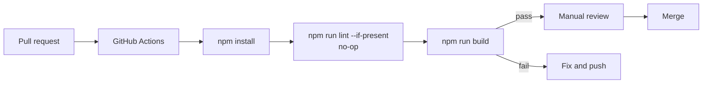

# Quality

Quality documentation explains how Atria is verified, what conventions the codebase follows, and where
gaps remain.

Atria currently has **no automated test suite** and **no linter configuration**. Quality relies on:

- a successful production build;
- GitHub Actions build verification;
- manual route, interaction, responsive, and accessibility checks;
- code review.

This section is honest about that state. It does not claim test coverage that does not exist.

---

## Documents

| Document | Purpose |
|---|---|
| [Testing strategy](testing-strategy.md) | Current verification model, manual test matrix, future test layers |
| [Accessibility](accessibility.md) | Present features, gaps, and manual checks |
| [Coding standards](coding-standards.md) | Observed conventions and recommended rules |
| [Review checklist](review-checklist.md) | Practical merge checklist |

---

## Current quality gates

### What is enforced automatically

- The dependency install must succeed.
- The production build must succeed.

### What is not enforced automatically

- Unit tests.
- Integration tests.
- End-to-end tests.
- Accessibility tests.
- Linting.
- Formatting.
- Type checking.
- Visual regression.

---

## Quality expectations

Even without automation, contributors are expected to:

1. Keep changes focused and explain them.
2. Run `npm run build` before pushing.
3. Perform relevant manual checks.
4. Update documentation with code changes.
5. Avoid claiming unimplemented functionality.
6. Keep interactive elements keyboard accessible.
7. Preserve responsive behaviour.
8. Respect reduced-motion preferences.

---

## Related documents

- [Testing strategy](testing-strategy.md)
- [Accessibility](accessibility.md)
- [Coding standards](coding-standards.md)
- [Review checklist](review-checklist.md)
- [CI/CD](../deployment/ci-cd.md)
